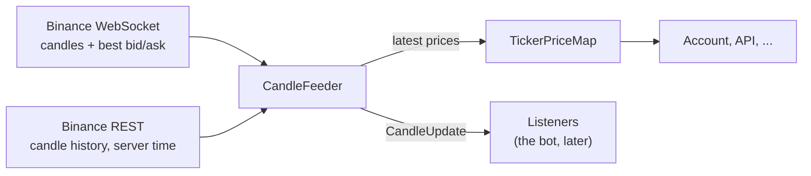

# Auto Trading Bot

A simulated crypto trading bot: a Java Spring Boot backend that runs the trading logic, and a React frontend that displays it. It reads real market data from Binance and trades against a virtual account. No real orders are ever sent.

The design is described in [docs/ARCHITECTURE.md](docs/ARCHITECTURE.md), with diagrams of how each part works.

## Status

| Part | Status |
|---|---|
| Market data: Binance WebSocket streams, REST candle history, ticker price map | Built |
| Account, orders and fees | Planned |
| Signal generators | Planned |
| Trading bot loop: Training and Trading modes | Planned |
| Database (raw SQL, no ORM) | Planned |
| REST API and React dashboard | Planned |

## How market data works



- One combined WebSocket connection carries every configured ticker (up to 512 tickers per connection).
- Each message is parsed, written to the price map and handed to listeners on a separate thread, so the connection never waits.
- A dropped connection reconnects after a fixed 5 seconds.

See [section 4 of the architecture](docs/ARCHITECTURE.md#4-market-data-built) for the full flow, startup, reconnects and failure handling.

## Project structure

```
.
├── README.md
├── pom.xml            aggregator: open the repository root in an IDE and the backend is picked up
├── docs/              architecture and design (docs/ARCHITECTURE.md)
├── frontend/          React UI (not set up yet)
└── backend/           Java Spring Boot project (Maven)
    └── src/main/java/com/tihomir/t212/tradingbot
        ├── broker         brokers (Binance) and the broker registry
        ├── marketdata     candle feed, WebSocket connections, market data events, ticker prices
        └── smoke          a short live check of the market data feed
```

## Prerequisites

- Java 21 (JDK)
- No Maven installation needed: the backend ships with the Maven wrapper (`mvnw` / `mvnw.cmd`), which downloads the correct Maven version on first use.
- Internet access to `data-stream.binance.vision` and `data-api.binance.vision` for live data. The tests don't need it.

## Backend

All commands are run from the `backend/` folder.

Run the tests (no network needed):

```bash
./mvnw test          # macOS / Linux / Git Bash
.\mvnw.cmd test      # Windows PowerShell / cmd
```

### See live market data

The `smoke` profile streams live Binance data for 30 seconds and logs it, then exits:

```bash
./mvnw spring-boot:run -Dspring-boot.run.profiles=smoke
.\mvnw.cmd spring-boot:run "-Dspring-boot.run.profiles=smoke"
```

It logs:
- 20 minutes of one-second candle history for the first ticker, fetched over REST
- every candle update from the WebSocket
- the latest quote (bid, ask, last price) per ticker every 5 seconds

Change the run length with `-Dspring-boot.run.arguments=--smoke.duration=2m`.

### Configuration

Tickers, the candle interval and the Binance endpoints are set in `backend/src/main/resources/application.yaml`:

```yaml
binance:
  interval: ONE_MINUTE
  tickers:
    - BTCUSDT
    - ETHUSDT
```

### Start the application

```bash
./mvnw spring-boot:run
.\mvnw.cmd spring-boot:run
```

Without a profile the application starts and stops straight away for now, because nothing runs by default yet. Use the `smoke` profile above to see it work.

Build a runnable jar:

```bash
./mvnw package
java -jar target/t212-spring-boot-project-0.0.1-SNAPSHOT.jar --spring.profiles.active=smoke
```

### Code quality

Code follows the [Google Java Style](https://google.github.io/styleguide/javaguide.html). Every push runs the same checks in GitHub Actions: formatting, Checkstyle, SpotBugs, then tests.

```bash
./mvnw verify          # tests + format check (Spotless) + Checkstyle + SpotBugs
./mvnw spotless:apply  # format the code
```

## Frontend

Not set up yet. Setup and run instructions will be added together with the React project.
