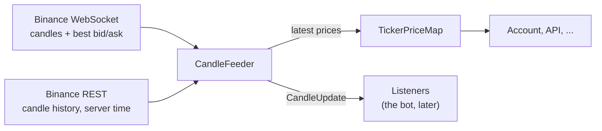
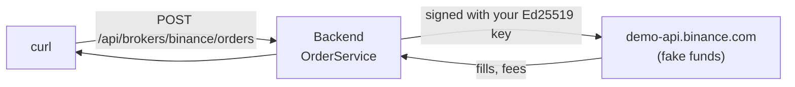

# Auto Trading Bot

A simulated crypto trading bot: a Java Spring Boot backend that runs the trading logic, and a React frontend that displays it. It reads market data from Binance and places orders on a **Binance Demo Mode** account, which uses fake funds. Orders are never sent to a live trading account.

The design is described in [docs/ARCHITECTURE.md](docs/ARCHITECTURE.md), with diagrams of how each part works.

## Status

| Part | Status |
|---|---|
| Market data: Binance WebSocket streams, REST candle history, ticker price map | Built |
| Demo account orders: market buy and sell, balances, over a REST API | Built |
| Virtual account, order validation and fees (Training) | Planned |
| Signal generators | Planned |
| Trading bot loop: Training and Trading modes | Planned |
| Database: PostgreSQL, raw SQL, no ORM | Planned, next |
| Rest of the REST API and the React dashboard | Planned |

## How market data works



- One combined WebSocket connection carries every configured ticker (up to 512 tickers per connection).
- Each message is parsed, written to the price map and handed to listeners on a separate thread, so the connection never waits.
- A dropped connection reconnects after a fixed 5 seconds.

See [section 4 of the architecture](docs/ARCHITECTURE.md#4-market-data-built) for the full flow, startup, reconnects and failure handling.

## Project structure

```
.
├── README.md
├── pom.xml            aggregator: open the repository root in an IDE and the backend is picked up
├── docs/              architecture and design (docs/ARCHITECTURE.md)
├── frontend/          React UI (not set up yet)
└── backend/           Java Spring Boot project (Maven)
    └── src/main/java/com/tihomir/t212/tradingbot
        ├── api            REST controllers
        ├── broker         brokers (Binance: market data, signed trading) and the broker registry
        ├── mode           the bot mode (trading, training), switched at runtime, and the live data starter
        ├── marketdata     candle feed, WebSocket connections, market data events, ticker prices
        ├── order          market orders, balances, the trading gateway interface
        └── smoke          a short live check of the market data feed
```

## Prerequisites

- Java 21 (JDK)
- No Maven installation needed: the backend ships with the Maven wrapper (`mvnw` / `mvnw.cmd`), which downloads the correct Maven version on first use.
- Internet access to `demo-stream.binance.com`, `data-api.binance.vision` and, for orders, `demo-api.binance.com`. The tests don't need it.
- For orders: a Binance account with Demo Trading enabled, and `openssl` to create a key pair (it ships with Git for Windows).

## Backend

All commands are run from the `backend/` folder.

Run the tests (no network needed):

```bash
./mvnw test          # macOS / Linux / Git Bash
.\mvnw.cmd test      # Windows PowerShell / cmd
```

### See live market data

The `smoke` profile streams live Binance data for 30 seconds and logs it, then shuts the application down. It also starts the web server, so stop any running instance first (port 8080):

```bash
./mvnw spring-boot:run -Dspring-boot.run.profiles=smoke
.\mvnw.cmd spring-boot:run "-Dspring-boot.run.profiles=smoke"
```

It logs:
- 20 minutes of one-second candle history for the first ticker, fetched over REST
- every candle update from the WebSocket
- the latest quote (bid, ask, last price) per ticker every 5 seconds

Change the run length with `-Dspring-boot.run.arguments=--smoke.duration=2m`.

### Configuration

Tickers, the candle interval and the Binance endpoints are set in `backend/src/main/resources/application.yaml`:

```yaml
binance:
  interval: ONE_MINUTE
  tickers:
    - BTCUSDT
    - ETHUSDT
```

### Start the application

```bash
./mvnw spring-boot:run
.\mvnw.cmd spring-boot:run
```

The server listens on `http://localhost:8080`. It streams live market data for every configured ticker, and demo account orders are on when the API key variables are set (see below).

The bot starts in `TRADING` mode (`bot.mode` in `application.yaml`) and can be switched to `TRAINING` and back while it runs, without a restart:

```bash
curl localhost:8080/api/bot/mode
curl -X PUT localhost:8080/api/bot/mode -H "Content-Type: application/json" -d '{"mode":"TRAINING"}'
```

Training uses trading: a training session can trade live between its training runs, so live data and orders stay available in both modes. Switching only changes the mode for now; the bot that acts on it comes later.

Build a runnable jar:

```bash
./mvnw package
java -jar target/t212-spring-boot-project-0.0.1-SNAPSHOT.jar
java -jar target/t212-spring-boot-project-0.0.1-SNAPSHOT.jar --spring.profiles.active=smoke
```

### Trade on the demo account



1. Create an Ed25519 key pair. Keep it **outside** the repository:
   ```bash
   mkdir -p ~/binance-demo
   openssl genpkey -algorithm ed25519 -out ~/binance-demo/private.pem
   openssl pkey -in ~/binance-demo/private.pem -pubout -out ~/binance-demo/public.pem
   ```
2. Log in to Binance, open **Demo Trading**, then **API Management**. Create a key of type **Ed25519** (self-generated) and paste the contents of `public.pem`. Copy the API key it shows.
3. Set the environment variables in the shell that starts the backend:
   ```bash
   export BINANCE_DEMO_API_KEY="<api key>"                                 # bash
   export BINANCE_DEMO_PRIVATE_KEY_PATH="$HOME/binance-demo/private.pem"
   ```
   ```powershell
   $env:BINANCE_DEMO_API_KEY = "<api key>"                                  # PowerShell
   $env:BINANCE_DEMO_PRIVATE_KEY_PATH = "$HOME\binance-demo\private.pem"
   ```
4. Start the backend (`./mvnw spring-boot:run`). The log says `binance: trading on the demo account at https://demo-api.binance.com`.
5. Check your balances, buy 10 USDT worth of BTC, then sell it again:
   ```bash
   curl localhost:8080/api/brokers/binance/balance

   curl -X POST localhost:8080/api/brokers/binance/orders -H "Content-Type: application/json" \
        -d '{"ticker":"BTCUSDT","side":"BUY","amount":"10","amountType":"QUOTE_AMOUNT"}'

   curl -X POST localhost:8080/api/brokers/binance/orders -H "Content-Type: application/json" \
        -d '{"ticker":"BTCUSDT","side":"SELL","amount":"0.00013","amountType":"BASE_QUANTITY"}'
   ```
   `QUOTE_AMOUNT` spends (or receives) that much USDT. `BASE_QUANTITY` is an amount of the coin. Binance requires it to be a multiple of the symbol's step size (`0.00001` for BTCUSDT) and worth at least the minimum order value (5 USDT for BTCUSDT). The buy's fee is taken in BTC, so sell a little less than the executed quantity, rounded down to the step size.

| Answer | Meaning |
|---|---|
| `200` | Balances: `{"balances": [{"asset": "USDT", "free": …, "locked": …}, …]}`. They're loaded at startup and refreshed from Binance after every executed order, so reading them sends no request to Binance |
| `201` | Executed. The body has the executed quantity, the USDT amount, the average price and each fill with its fee |
| `400` | Bad request body, or a ticker that isn't configured |
| `409` | The environment variables aren't set |
| `422` | Binance refused the order, e.g. insufficient balance or below the minimum order size. `exchangeErrorCode` holds Binance's code |
| `502` | No clear answer from Binance. The order may still have been executed: look it up on the demo account by `clientOrderId` |

The configuration only accepts `demo-api.binance.com` as the trading host, so a live account can't be traded by mistake.

### Code quality

Code follows the [Google Java Style](https://google.github.io/styleguide/javaguide.html). Every push runs the same checks in GitHub Actions: formatting, Checkstyle, SpotBugs, then tests.

```bash
./mvnw verify          # tests + format check (Spotless) + Checkstyle + SpotBugs
./mvnw spotless:apply  # format the code
```

## Frontend

Not set up yet. Setup and run instructions will be added together with the React project.
