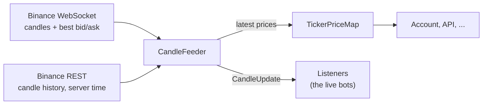
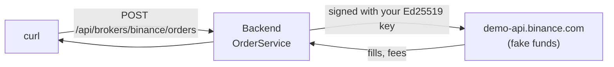

# Auto Trading Bot

A simulated crypto trading bot: a Java Spring Boot backend that runs the trading logic, and a React frontend that displays it. It reads market data from Binance and places orders on a **Binance Demo Mode** account, which uses fake funds. Orders are never sent to a live trading account.

The design is described in [docs/ARCHITECTURE.md](docs/ARCHITECTURE.md), with diagrams of how each part works.

## Quick start

You need Java 21, Node.js 20.19+, Docker (running) and Git. Maven comes with the project (`mvnw`).

1. Clone the repository:
   ```bash
   git clone https://github.com/ShadowOfDiablo/t212-coding-task.git
   cd t212-coding-task
   ```
2. Optional, for trading on the Binance demo account: create a demo API key and set `BINANCE_DEMO_API_KEY` and `BINANCE_DEMO_PRIVATE_KEY_PATH`, as described in [Trade on the demo account](#trade-on-the-demo-account). Without them, market data and backtests still work.
3. Start the backend. It starts PostgreSQL in Docker by itself and runs on http://localhost:8080:
   ```bash
   cd backend
   ./mvnw spring-boot:run        # Windows: .mvnw.cmd spring-boot:run
   ```
4. In a second terminal, start the dashboard:
   ```bash
   cd frontend
   npm install
   npm run dev
   ```
5. Open http://localhost:5173. Use the Training switch at the top to run backtests and tunings, and Trading to run the live bots.

Run the tests with `./mvnw verify` in `backend/` (Docker must be running for the database tests).

## Status

| Part | Status |
|---|---|
| Market data: Binance WebSocket streams, REST candle history, ticker price map | Built |
| Demo account orders: market buy and sell, balances, over a REST API | Built |
| Order checks for every order (cash, order size, stop loss, take profit, minimum value) and a virtual account for training | Built |
| Trading algorithms: required and optional settings, stored once and reused (`GET /api/algorithms`), SMA example | Built |
| Training runs (backtests): replay stored candles on a virtual account, recorded with their settings | Built |
| Automatic tuning with TPE: tune on part of the range, check on the rest, keep only the best tuned run | Built |
| Live trading bots on the demo account: one per followed ticker, each with its own settings and budget | Built |
| Pause, resume, start all, stop all, and an account reset with reset markers on the chart | Built |
| Database: PostgreSQL + Flyway, raw SQL, no ORM. Orders, runs, settings, positions and trades with P&L | Built |
| Account value over time, sampled every minute and kept in memory | Built |
| React dashboard: live bots, backtests and tuning, recorded runs, trades on a price chart, holdings, orders | Built |
| Auto-tune per ticker until a better variant is found, with a stop button | Planned, next |
| Restart reconciliation, background training, server-sent events | Planned |

## How market data works



- One combined WebSocket connection carries every configured ticker (up to 512 tickers per connection).
- Each message is parsed, written to the price map and handed to listeners on a separate thread, so the connection never waits.
- A dropped connection reconnects after a fixed 5 seconds.

See [section 4 of the architecture](docs/ARCHITECTURE.md#4-market-data-built) for the full flow, startup, reconnects and failure handling.

## Project structure

```
.
├── README.md
├── pom.xml            aggregator: open the repository root in an IDE and the backend is picked up
├── docs/              architecture and design (docs/ARCHITECTURE.md)
├── frontend/          React UI (JavaScript, built with Vite)
└── backend/           Java Spring Boot project (Maven)
    └── src/main/java/com/tihomir/t212/tradingbot
        ├── account        the account reset, and the account value history (account/value)
        ├── algorithm      trading algorithms, their settings and saved settings, the SMA indicator
        ├── api            REST controllers, request bodies and response DTOs
        ├── bot            live bots (bot/live, its queue in bot/live/queue), ticker settings,
        │                  training, tuning and recorded runs
        ├── broker         brokers (Binance: market data, signed trading) and the broker registry
        ├── database       PostgreSQL access (raw SQL through JdbcClient)
        ├── mode           the bot mode (trading, training), switched at runtime, and the live data starter
        ├── marketdata     candle feed, candle history, WebSocket connections, ticker prices
        ├── order          market orders, order checks, the balance cache and its sync, the gateways
        ├── position       positions as FIFO lots, with their trades and P&L
        ├── userdata       the user data stream connection (account events), separate from market data
        └── smoke          a short live check of the market data feed
```

## Prerequisites

- Java 21 (JDK)
- No Maven installation needed: the backend ships with the Maven wrapper (`mvnw` / `mvnw.cmd`), which downloads the correct Maven version on first use.
- Internet access to `demo-stream.binance.com`, `data-api.binance.vision` and, for orders, `demo-api.binance.com`. The tests don't need it.
- For orders: a Binance account with Demo Trading enabled, and `openssl` to create a key pair (it ships with Git for Windows).
- Node.js 20.19 or newer (with npm) for the frontend.
- Docker (Docker Desktop on Windows and macOS), running. The application stores orders in PostgreSQL, which runs in Docker, and the database tests use Testcontainers. Without Docker the database tests are skipped.

## Backend

All commands are run from the `backend/` folder.

Run the tests (no network needed; the database tests start their own PostgreSQL in Docker):

```bash
./mvnw test          # macOS / Linux / Git Bash
.\mvnw.cmd test      # Windows PowerShell / cmd
```

### See live market data

The `smoke` profile streams live Binance data for 30 seconds and logs it, then shuts the application down. It also starts the web server, so stop any running instance first (port 8080):

```bash
./mvnw spring-boot:run -Dspring-boot.run.profiles=smoke
.\mvnw.cmd spring-boot:run "-Dspring-boot.run.profiles=smoke"
```

It logs:
- 20 minutes of one-second candle history for the first ticker, fetched over REST
- every candle update from the WebSocket
- the latest quote (bid, ask, last price) per ticker every 5 seconds

Change the run length with `-Dspring-boot.run.arguments=--smoke.duration=2m`.

### Configuration

Tickers, the candle interval and the Binance endpoints are set in `backend/src/main/resources/application.yaml`:

```yaml
binance:
  interval: ONE_MINUTE
  tickers: [BTCUSDT, ETHUSDT, USDCUSDT, SOLUSDT, DOGEUSDT, PEPEUSDT]
```

These six are followed by default. More can be followed at runtime from the dashboard or with `POST /api/brokers/binance/tickers`.

### The database

Orders are stored in **PostgreSQL 17**, and **Flyway** creates the tables at startup from the SQL scripts in `backend/src/main/resources/db/migration`. `spring-boot:run` starts the database from `backend/compose.yaml` and leaves it running, so Docker must be running first. To manage it yourself:

```bash
docker compose up -d      # start PostgreSQL (from backend/)
docker compose down       # stop it; the data stays in the tradingbot-data volume
```

The connection defaults to `jdbc:postgresql://localhost:5432/tradingbot` (user and password `tradingbot`). Override it with `TRADING_BOT_DB_URL`, `TRADING_BOT_DB_USER` and `TRADING_BOT_DB_PASSWORD`.

### Start the application

```bash
./mvnw spring-boot:run
.\mvnw.cmd spring-boot:run
```

The server listens on `http://localhost:8080`. It streams live market data for every configured ticker, and demo account orders are on when the API key variables are set (see below).

The bot starts in `TRADING` mode (`bot.mode` in `application.yaml`) and can be switched to `TRAINING` and back while it runs, without a restart:

```bash
curl localhost:8080/api/bot/mode
curl -X PUT localhost:8080/api/bot/mode -H "Content-Type: application/json" -d '{"mode":"TRAINING"}'
```

Training uses trading: a training session can trade live between its training runs, so live data and orders stay available in both modes. Switching only changes the mode for now; the bot that acts on it comes later.

Build a runnable jar:

```bash
./mvnw package
java -jar target/t212-spring-boot-project-0.0.1-SNAPSHOT.jar
java -jar target/t212-spring-boot-project-0.0.1-SNAPSHOT.jar --spring.profiles.active=smoke
```

### Trade on the demo account



1. Create an Ed25519 key pair. Keep it **outside** the repository:
   ```bash
   mkdir -p ~/binance-demo
   openssl genpkey -algorithm ed25519 -out ~/binance-demo/private.pem
   openssl pkey -in ~/binance-demo/private.pem -pubout -out ~/binance-demo/public.pem
   ```
2. Log in to Binance, open **Demo Trading**, then **API Management**. Create a key of type **Ed25519** (self-generated) and paste the contents of `public.pem`. Copy the API key it shows.
3. Set the environment variables in the shell that starts the backend:
   ```bash
   export BINANCE_DEMO_API_KEY="<api key>"                                 # bash
   export BINANCE_DEMO_PRIVATE_KEY_PATH="$HOME/binance-demo/private.pem"
   ```
   ```powershell
   $env:BINANCE_DEMO_API_KEY = "<api key>"                                  # PowerShell
   $env:BINANCE_DEMO_PRIVATE_KEY_PATH = "$HOME\binance-demo\private.pem"
   ```
4. Start the backend (`./mvnw spring-boot:run`). The log says `binance: trading on the demo account at https://demo-api.binance.com`.
5. Check the traded tickers and your balances, buy 10 USDT worth of BTC, then sell it again:
   ```bash
   curl localhost:8080/api/brokers/binance/tickers
   curl localhost:8080/api/brokers/binance/balance

   curl -X POST localhost:8080/api/brokers/binance/orders -H "Content-Type: application/json" \
        -d '{"ticker":"BTCUSDT","side":"BUY","amount":"10","amountType":"QUOTE_AMOUNT"}'

   curl -X POST localhost:8080/api/brokers/binance/orders -H "Content-Type: application/json" \
        -d '{"ticker":"BTCUSDT","side":"SELL","amount":"0.00013","amountType":"BASE_QUANTITY"}'
   ```
   `QUOTE_AMOUNT` spends (or receives) that much USDT. `BASE_QUANTITY` is an amount of the coin. Binance requires it to be a multiple of the symbol's step size (`0.00001` for BTCUSDT) and worth at least the minimum order value (5 USDT for BTCUSDT). The buy's fee is taken in BTC, so sell a little less than the executed quantity, rounded down to the step size.

| Answer | Meaning |
|---|---|
| `200` | Balances: `{"balances": [{"asset": "USDT", "free": …, "locked": …}, …]}`. They're kept in sync by Binance's user data stream (plus a full sync every 15 minutes), so reading them sends no request to Binance |
| `201` | Executed. The body has the executed quantity, the USDT amount, the average price and each fill with its fee |
| `400` | Bad request body, or a ticker that isn't configured |
| `409` | The environment variables aren't set |
| `422` | Binance refused the order, e.g. insufficient balance or below the minimum order size. `exchangeErrorCode` holds Binance's code |
| `502` | No clear answer from Binance. The order may still have been executed: look it up on the demo account by `clientOrderId` (the bot's `tb-…` id) |
| `503` | The database is unavailable (when reading orders) |

Once Binance answers, an executed order is stored in the history with its fills, under Binance's order id. A refused order goes to the rejected orders. Open orders will list orders still resting on Binance once take-profit and stop-loss orders exist:

```bash
curl localhost:8080/api/brokers/binance/orders/open
curl localhost:8080/api/brokers/binance/orders/history
curl localhost:8080/api/brokers/binance/orders/rejected
```

**Live round-trip test.** `DemoAccountRoundTripLiveTest` starts the whole application and places **real orders on your demo account**. It buys 10 USDT of the first traded ticker and checks the order is `FILLED`, in the history, and that the coin balance goes up. Then it sells 9.5 USDT of it (a little less, because the buy fee was taken in the coin) and checks the balance goes down. A little dust stays behind. It only runs when you ask for it, with the API key variables set and Docker running:

```bash
BINANCE_DEMO_LIVE_TESTS=true ./mvnw test -Dtest=DemoAccountRoundTripLiveTest           # bash
$env:BINANCE_DEMO_LIVE_TESTS = "true"; .\mvnw.cmd test "-Dtest=DemoAccountRoundTripLiveTest"   # PowerShell
```

In normal builds and in CI it is skipped.

The trading and user data URLs must point to the demo hosts set in `application.yaml` (`binance.trading.demo-host`, `binance.user-data-stream.demo-host`), otherwise the application refuses to start, so a live account can't be traded by mistake.

### Run a training

Training replays a past period of real Binance candles through a trading algorithm on a virtual account, as fast as possible. Nothing is sent to Binance except public candle requests. It only runs in `TRAINING` mode:

```bash
curl -X PUT localhost:8080/api/bot/mode -H "Content-Type: application/json" -d '{"mode":"TRAINING"}'
curl localhost:8080/api/algorithms
curl -X POST localhost:8080/api/brokers/binance/training/runs -H "Content-Type: application/json" -d '{
  "candles": {"ticker": "BTCUSDT", "from": "2021-01-01T00:00:00Z", "to": "2021-03-01T00:00:00Z"},
  "settings": {"algorithmType": "SIMPLE_MOVING_AVERAGE", "timeframe": "5m", "liveOnTick": true,
               "timePeriod": 50, "orderSizePercent": 100, "stopLossPercent": 2, "takeProfitPercent": 5},
  "startingBalance": 10000}'
```

- **Settings:** left-out required settings take their default; left-out optional ones (`stopLossPercent`, `takeProfitPercent`) skip their checks. `updateTimeSeconds` is set exactly when `liveOnTick` is false. Invalid bodies are refused with 400 naming the fields.
- **Candles** are downloaded once, 1,000 at a time, and read from the database after that.
- **Orders:** every signal goes through the order checks, then fills at the next candle's open with Binance's 0.1% fee.
- **Recorded runs:** every run is stored with the settings it used at start and at the end. Identical settings are stored once.
  - `GET /api/brokers/binance/runs` and `GET /api/brokers/binance/runs/{id}`
  - `GET /api/brokers/binance/training` tells whether a run is going (`running` is true while it does)

In `TRADING` mode a training run is refused with 409, and so is a second run while one is going.

**Tuning** searches for better settings with TPE: `POST /api/brokers/binance/training/tunings` takes the same candles and settings, plus `checkFrom`, which settings may change and the number of tries. The tries run on `[from, checkFrom)`. The best one is recorded as a run over the whole range, so its return after `checkFrom` shows how it does on data it never saw. Only the ticker's best tuned run is kept.

### Run the live bots

Each followed ticker has its own live bot, with its own settings and its own budget in USDT. A bot spends only its budget and keeps its own profit or loss. It only runs in `TRADING` mode, with the demo API key set:

```bash
curl -X PUT localhost:8080/api/brokers/binance/ticker-settings/BTCUSDT -H "Content-Type: application/json" -d '{
  "settings": {"algorithmType": "SIMPLE_MOVING_AVERAGE", "timeframe": "1m", "liveOnTick": true, "timePeriod": 20},
  "budget": 1000}'
curl -X POST localhost:8080/api/brokers/binance/bots/BTCUSDT/start
curl localhost:8080/api/brokers/binance/bots
curl -X POST localhost:8080/api/brokers/binance/bots/BTCUSDT/pause
curl -X POST localhost:8080/api/brokers/binance/bots/stop-all
```

- **Prices** go through one queue per broker and a pool of workers. Different tickers are evaluated in parallel, one ticker never twice at once, and a failed evaluation is retried at most 3 times.
- **Stopping** a bot records its run and makes its final value the ticker's new budget.
- **Account reset:** `POST /api/brokers/binance/account/reset` sells everything into USDT so the demo account can be reset on Binance. The reset shows as a marker on the live chart.
- **Account value:** `GET /api/brokers/binance/account/value-points` is the whole account's value, sampled every minute since the backend started. It is kept in memory only.

### Code quality

Code follows the [Google Java Style](https://google.github.io/styleguide/javaguide.html). Every push runs the same checks in GitHub Actions: formatting, Checkstyle, SpotBugs, then tests.

```bash
./mvnw verify          # tests + format check (Spotless) + Checkstyle + SpotBugs
./mvnw spotless:apply  # format the code
```

## Frontend

A React app written in plain JavaScript (`.jsx`), with HTML and CSS. [Vite](https://vite.dev) runs the dev server and builds it. All commands are run from the `frontend/` folder:

```bash
npm install          # first time only
npm run dev          # dev server on http://localhost:5173
npm run build        # production build into frontend/dist
npm run lint         # lint with oxlint
```

During `npm run dev`, requests to `/api` are forwarded to the backend on `http://localhost:8080`, so start the backend first.

The dashboard has three tabs:

- **Live bot:** pick a ticker's bot, set its budget and settings, start, pause or stop it, or start and stop all of them. The chart shows all live runs of the ticker or just this run, from 1D to MAX.
- **Training:** run a backtest or tune the settings. The result shows the portfolio value, the instrument's price with the trades on it, and the trade history.
- **Runs:** every recorded run, page by page, with its chart and trades.

Above the tabs, four ticker cards show the pinned tickers first, then the biggest holdings; the other tickers sit in a side list where they can be pinned. Below, the orders and the holdings, with a chart of the whole account value.
