# Architecture

## 1. Overview

The application simulates an autonomous crypto trading bot. It reads market data from Binance, generates trading signals and executes **simulated** orders against a virtual account. No real orders are ever sent to an exchange.

| Mode | Data source | Purpose |
|---|---|---|
| `TRAINING` (backtest) | Historical Binance data (REST) | Run the bot over a past period to analyse it |
| `TRADING` (live-sim) | Live Binance streams (WebSocket) | Run the bot on live prices |

Both modes run **the same pipeline and the same logic**. Only the source of events differs. No look-ahead: an event only ever sees the data the candle feed has delivered up to that event's execution time.

### Status

| Part | Status |
|---|---|
| Market data: brokers, candle feeder, WebSocket streams, REST history, ticker price map | **Built** |
| Account, orders, fees | Planned |
| Signal generators and indicators | Planned |
| `TradingBotService`: event loop, states, controls | Planned |
| Persistence (raw SQL) | Planned |
| REST API and React dashboard | Planned |

### System overview

Solid boxes are built; dashed boxes are planned.

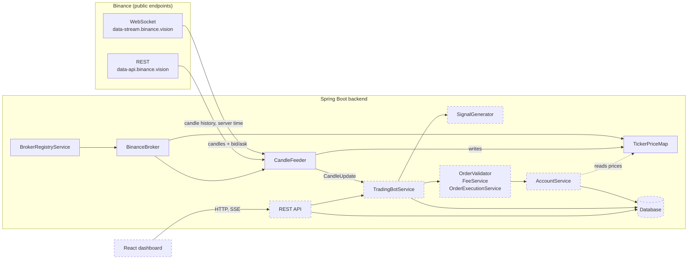

## 2. Components

| Component | Status | Responsibility |
|---|---|---|
| `Broker` | Built | One exchange: name, tickers, candle feeder and ticker price map. `AbstractBroker` is the abstract factory; `BinanceBroker` is the first implementation. One singleton per exchange |
| `BrokerRegistryService` | Built | Holds every broker by name, so several brokers can run at once. Rejects duplicate names |
| `CandleFeeder` | Built | One shared class for all brokers: WebSocket connections, grouping streams by connection, history paging, exchange clock offset. Writes the broker's ticker price map and hands `CandleUpdate`s to listeners. Never touches the account |
| `ExchangeMarketDataProtocol` | Built | The exchange-specific part of market data: stream names, URLs, limits, message parsing |
| `MarketDataStreamConnection` | Built | One WebSocket connection with a fixed 5-second reconnect (`JdkWebSocketConnection`) |
| `TickerPriceMap` | Built | Latest quote per ticker, per broker. Written by the candle feeder (`TickerPriceWriter`), read by everyone else (`TickerPriceReader`) |
| `TradingBotService` | Planned | Owns the event loop, the bot state and the runs |
| `SignalGenerator` | Planned | Interface for trading logic, with several implementations chosen by config. Returns `Buy`, `Sell` or `Hold` |
| `OrderValidator` | Planned | Turns a signal into a valid `OrderRequest`, or rejects it |
| `FeeService` | Planned | Provides fee rates (exact Binance rates with an API key, the standard schedule otherwise) and calculates fees |
| `OrderExecutionService` | Planned | Fills a valid `OrderRequest` and produces an `ExecutedOrder`. No validation or fee logic |
| `AccountService` | Planned | Applies `ExecutedOrder`s to cash and positions, and calculates P&L and portfolio value |
| Repositories | Planned | Raw SQL persistence (`JdbcClient`), with no ORM |
| REST API | Planned | Controls and read endpoints for the React dashboard |

Components exchange immutable DTOs (Java records): `CandleUpdate`, `BidAskUpdate`, `Signal`, `OrderRequest`, `ExecutedOrder`, `TradeHistoryEntry`, `PortfolioSnapshot`.

## 3. Event pipeline (planned)

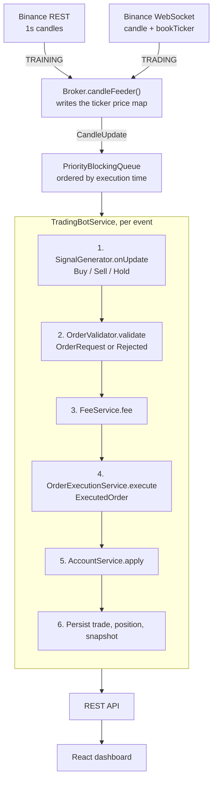

## 4. Market data (built)

### 4.1 Brokers

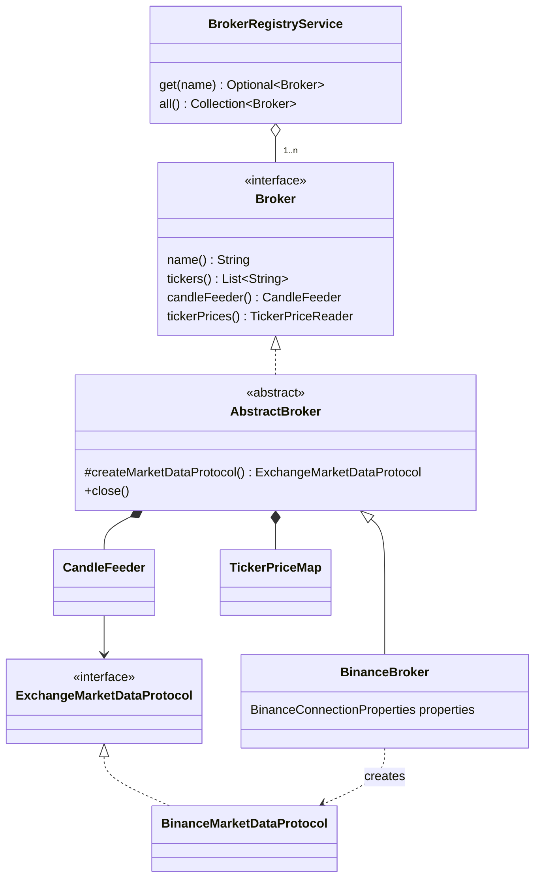

- Every broker is a Spring singleton. The registry fails at startup if two brokers share a name.
- Each broker *has* a `CandleFeeder` (composition), built on the first call to `candleFeeder()`. The feeder logic is shared; only the `ExchangeMarketDataProtocol` differs per exchange.
- `BinanceBroker` reads its settings from `binance.*` in `application.yaml` (`BinanceConnectionProperties`). Startup fails if no tickers are configured.
- Planned: a portfolio per broker, transfers between brokers (which take time), and an `OrderGateway` factory method. Orders go to the Binance Spot Testnet first, then to real Binance's validate-only `POST /api/v3/order/test`.

### 4.2 Live data flow

Three kinds of threads touch market data. The WebSocket thread does only quick work, so it can ask for the next message straight away.

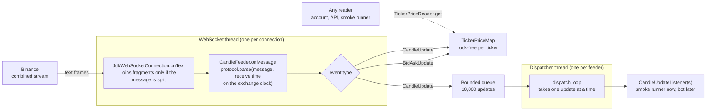

1. A text frame arrives. A message that arrives in one piece is handed on directly; a split message is collected and the buffer is released afterwards.
2. `ExchangeMarketDataProtocol.parse` turns it into a `CandleUpdate`, a `BidAskUpdate`, or nothing (for example a subscription acknowledgement).
3. **`BidAskUpdate`:** updates bid and ask in the price map.
4. **`CandleUpdate`:** updates the last price in the price map and is offered to the queue. If the queue is full the update is dropped with a warning; the socket is never blocked.
5. The connection then asks for the next message (`request(1)` in a `finally`, so a failure never stalls the stream).
6. The dispatcher thread hands each `CandleUpdate` to every listener. A failing listener is logged and the others still run.

### 4.3 Starting a feeder

`start()` is all or nothing: either every connection opens, or everything is closed again and the error is passed on.

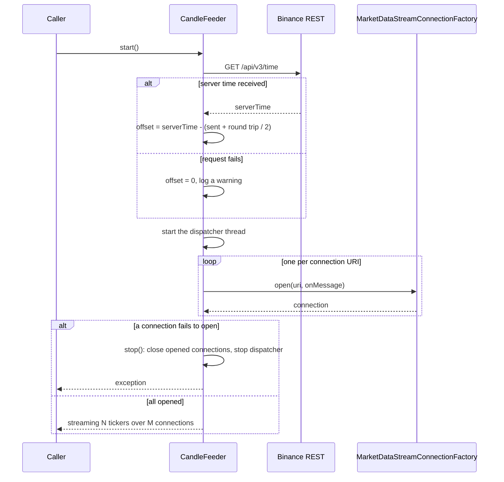

### 4.4 Grouping streams into connections

One connection carries up to 1,024 streams (Binance's limit). Every ticker has 2 streams (candle and bid/ask), and a ticker's streams never get split across connections.

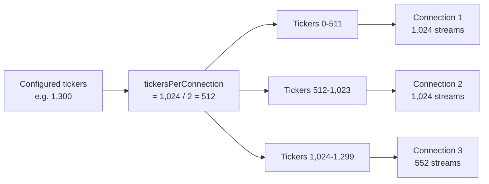

Each connection URI is a combined stream, for example:

```
wss://data-stream.binance.vision/stream?streams=btcusdt@kline_1m/btcusdt@bookTicker/ethusdt@kline_1m/ethusdt@bookTicker
```

With the two default tickers this is a single connection.

### 4.5 Connection lifecycle

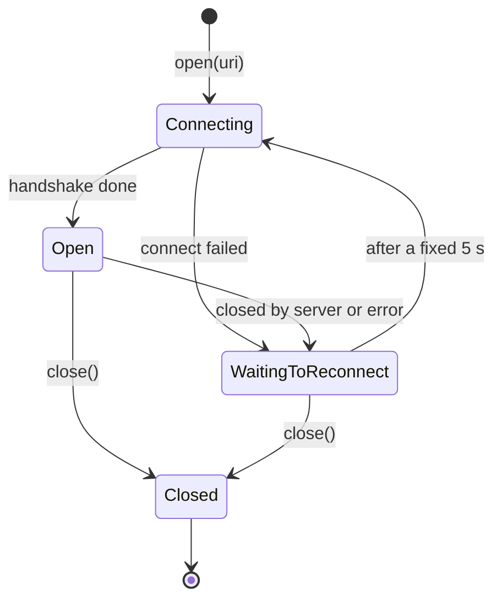

- Pings are answered with pongs. Binance drops every connection after 24 hours; it reconnects like any other drop.
- The fixed 5-second delay stays well under Binance's limit of 300 connection attempts per 5 minutes per IP.
- If the reconnect scheduler is shutting down, no reconnect is scheduled and that is logged.

### 4.6 Candle history over REST

`history(ticker, interval, from, to)` pages `GET /api/v3/klines` (Binance calls candles "klines"), up to 1,000 candles per request.

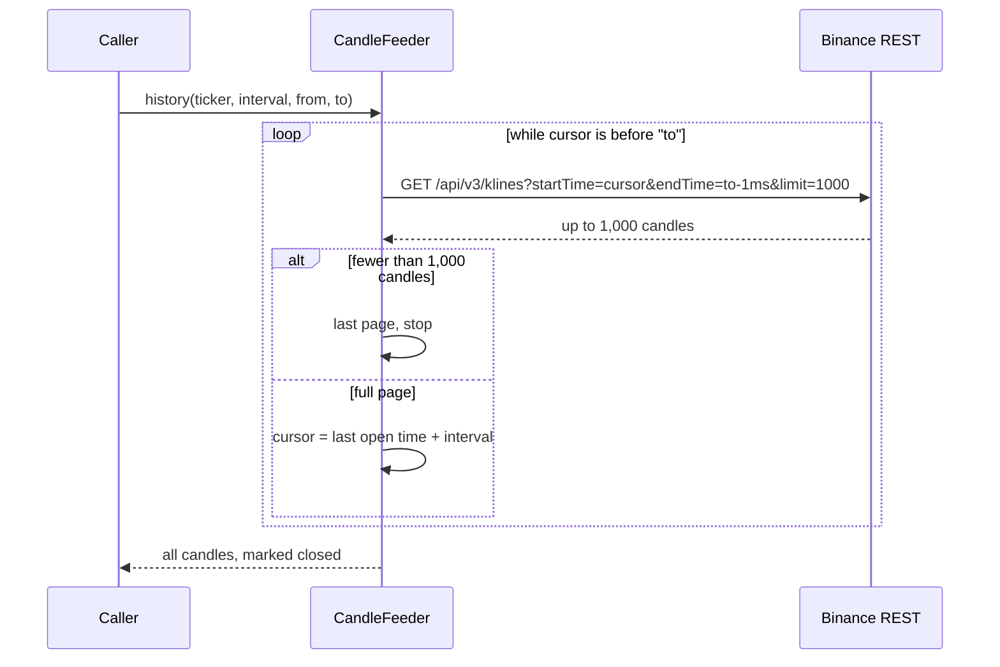

### 4.7 Market data events

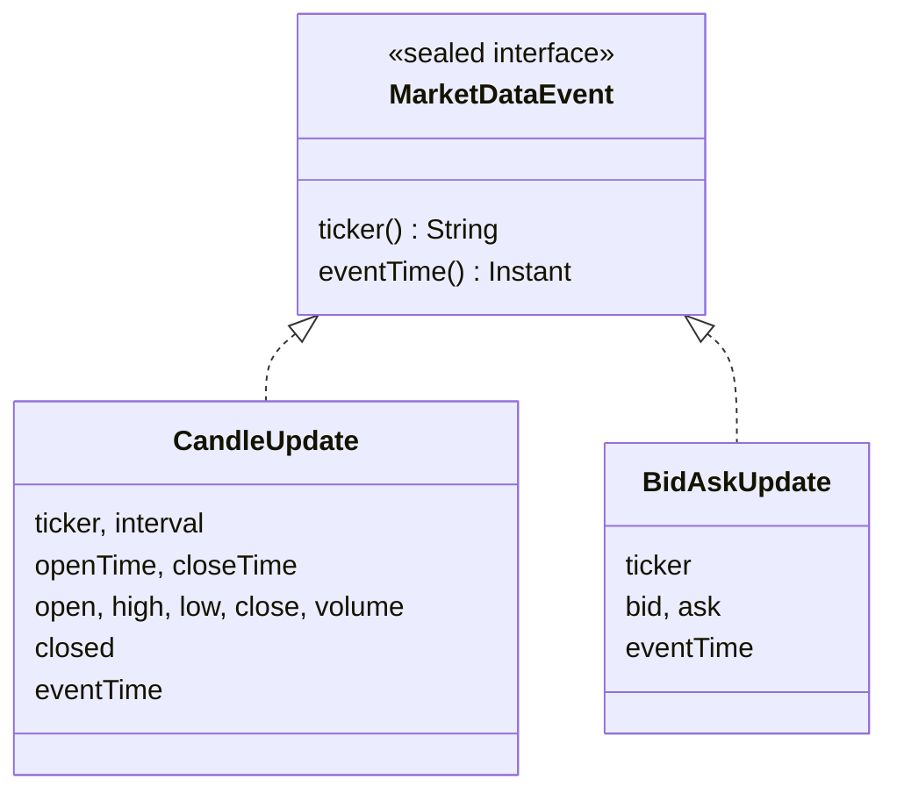

Every event time is on the **exchange's clock**:

| Event | Where `eventTime` comes from |
|---|---|
| Live `CandleUpdate` | Binance's event time (`"E"`) |
| History `CandleUpdate` | The candle's close time |
| `BidAskUpdate` | Binance's spot `@bookTicker` has no event time, so the receive time shifted by the exchange clock offset measured on start |

A `CandleUpdate` is the current state of the forming candle plus `closed`.
- **Trading:** the candle stream sends an update every 1–2 seconds. Each update becomes an event.
- **Training (planned):** the same updates are rebuilt from historical **`1s` candles**. They're aggregated into the forming candle of the chosen interval and emitted one second at a time. A day is about 86,400 `1s` candles, which is 87 requests.
- **Cache (planned):** historical candles are stored in the database after the first download, so re-runs use identical data and don't call Binance again.

### 4.8 Failure handling

| What fails | What happens |
|---|---|
| Unreadable message | Logged as a warning, the stream continues |
| Listener throws | Logged, the other listeners and later updates still run |
| Dispatch queue full | Update dropped with a warning; the price map is still updated |
| Connection drops or errors | Reconnect after a fixed 5 seconds |
| Reconnect itself throws | The next reconnect is scheduled |
| Answering a ping fails | Logged, the stream continues |
| Server time unavailable on start | Local clock used, warning logged |
| A connection fails during `start()` | Everything opened so far is closed and the error is passed on |

### 4.9 Binance endpoints (public, no key needed)

| Endpoint | Used for |
|---|---|
| `wss://data-stream.binance.vision/stream?streams=…` | `<symbol>@kline_<interval>` candles and `<symbol>@bookTicker` best bid/ask, JDK `java.net.http.WebSocket` |
| `GET /api/v3/klines` on `data-api.binance.vision` | Candle history, 1,000 per request |
| `GET /api/v3/time` | Exchange clock offset |
| `GET /api/v3/exchangeInfo` (planned) | Trading rules per symbol: minimum quantity, step size, minimum order value |

## 5. Ticker price map (built)

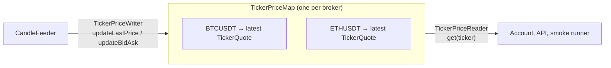

Each broker has a `TickerPriceMap`: its configured tickers mapped to the latest `TickerQuote` (bid, ask, last price, update time, source).
- The key set is fixed at startup. Each value starts **empty** and is filled only by a valid REST fetch or a WebSocket message for that ticker. Updates for other tickers are ignored.
- Values are `AtomicReference<TickerQuote>`s, so updates are lock-free and readers never see a half-written quote.
- A candle update sets the last price; a bid/ask update sets bid and ask. Each keeps the other's fields.
- **`TickerPriceWriter`:** only the broker's `CandleFeeder` receives it.
- **`TickerPriceReader`:** every other component receives it. Read-only by type.
- **Training mode (planned):** the feeder must not run ahead of the bot, so in Training it releases events one at a time and writes each price only as it releases that event. The map never shows a "future" price.

## 6. Signals (planned)

`SignalGenerator.onUpdate(CandleUpdate, SignalContext)` runs on **every candle update** in both modes. `SignalContext` gives read-only access to recent candles, indicators, the open position and the cash balance.

| Signal | Parameters | Meaning |
|---|---|---|
| `Buy` | size (quantity or quote amount) | Open or add to a position |
| `Sell` | size (quantity, or all) | Reduce or close a position |
| `Hold` | none | Do nothing |

Indicators (SMA, EMA, RSI, …) are separate, reusable classes under `signal/indicator`.

## 7. Orders (planned)

### Order lifecycle (first version: market orders only)

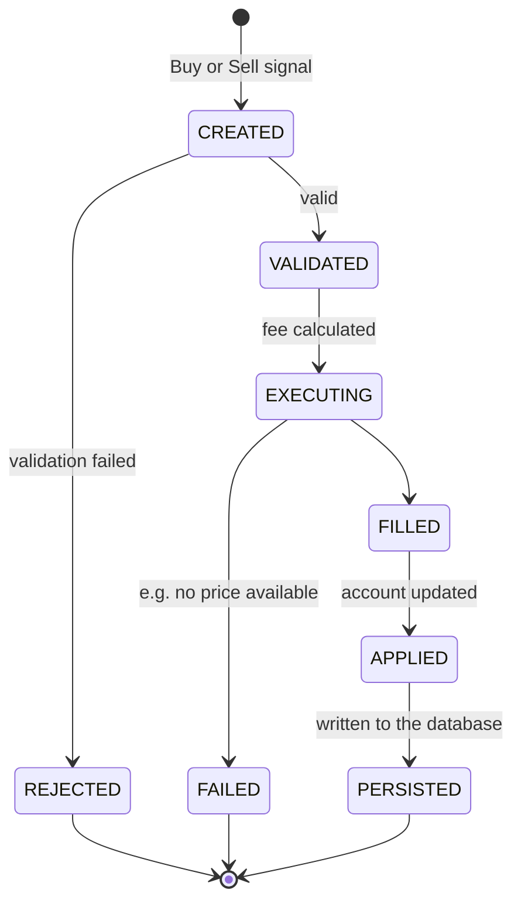

| State | Set by | Meaning |
|---|---|---|
| `CREATED` | `TradingBotService` | Built from a `Buy` or `Sell` signal |
| `VALIDATED` | `OrderValidator` | Passed all checks |
| `REJECTED` | `OrderValidator` | Failed a check, with a reason. Logged and kept for the dashboard |
| `EXECUTING` | `OrderExecutionService` | Fill in progress |
| `FILLED` | `OrderExecutionService` | Price and quantity are final |
| `FAILED` | `OrderExecutionService` | Couldn't be filled. The bot goes to `ERROR` if it repeats |
| `APPLIED` | `AccountService` | Cash and position updated |
| `PERSISTED` | Repository | Saved. Only now is the next event allowed to depend on it |

**Rejection reasons:**
- `INSUFFICIENT_FUNDS`
- `INSUFFICIENT_HOLDINGS` (selling more than is held)
- `NO_POSITION` (selling with nothing open)
- `BELOW_MIN_QUANTITY` / `BELOW_MIN_NOTIONAL` (Binance `exchangeInfo` rules)
- `BOT_NOT_RUNNING`

Quantities are rounded down to the symbol's step size before validation.

### Fill price

| Mode | Buy | Sell |
|---|---|---|
| `TRADING` | Best **ask** at the moment of the signal (`bookTicker`) | Best **bid** |
| `TRAINING` | Open of the next `1s` candle after the signal | Same |

### Fees

`FeeService` uses the exact rates from Binance's signed `GET /api/v3/account/commission` when a **read-only** API key is configured. The key comes from environment variables and is never committed. Without a key, it uses the standard schedule: 0.1% maker and 0.1% taker.
- Market orders pay the taker rate.
- The fee is charged in the received asset: the base coin on a buy, the quote coin on a sell.
- Rates are cached and refreshed periodically. Calculating a fee is a direct call.

### Later order types

These plug into the same lifecycle:
- `LIMIT`, `STOP_LOSS` and `TAKE_PROFIT` orders, plus their `*_LIMIT` variants.
- OCO brackets and trailing stops.
- Time in force (`GTC`, `IOC`, `FOK`).

They add a `PENDING` state, held in an in-memory open-orders book and checked on every update:

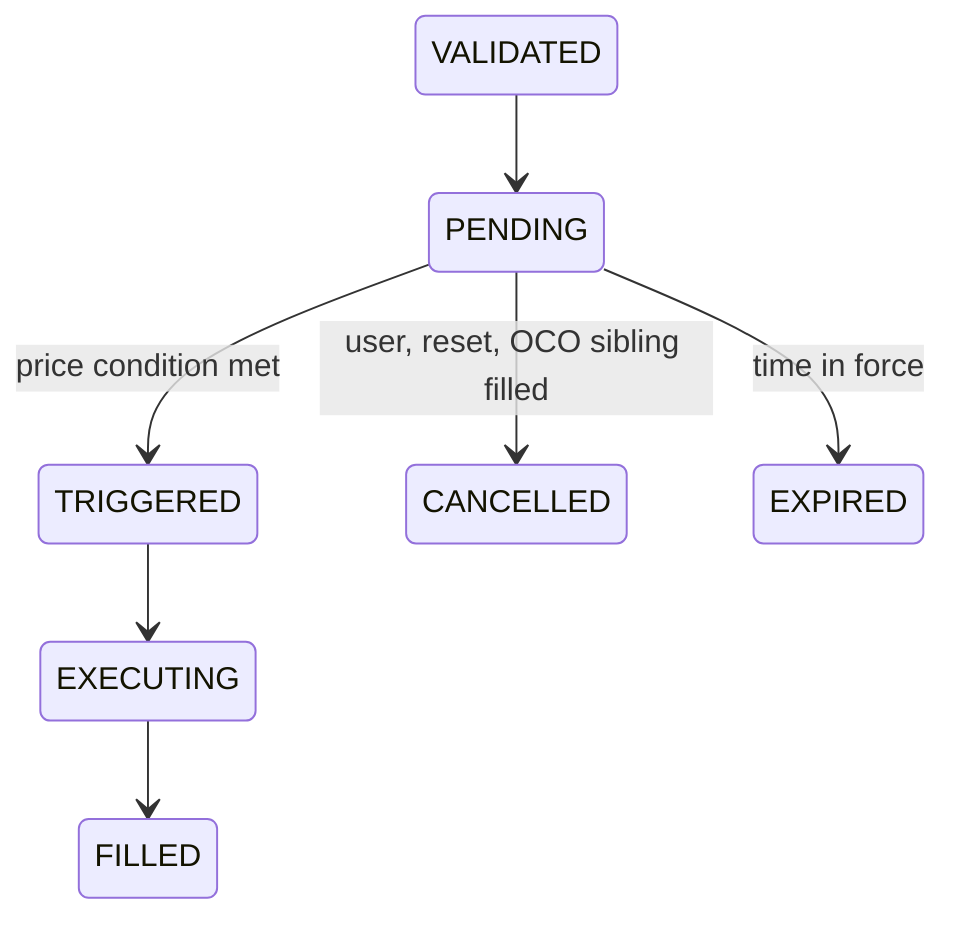

## 8. Account and positions (planned)

- The account has a cash balance in the quote currency (e.g. USDT), plus one position per ticker (quantity and average entry price).
- `AccountService.apply(ExecutedOrder)` follows these rules:
  - **Buy, no position:** opens a position. Cash decreases by price × quantity, and the fee is taken from the coin received.
  - **Buy, existing position:** adds the quantity and recalculates the average entry price.
  - **Sell, partial:** reduces the quantity. Realised P&L = (price − average entry) × quantity − fee.
  - **Sell, full:** closes the position, with the same P&L calculation.

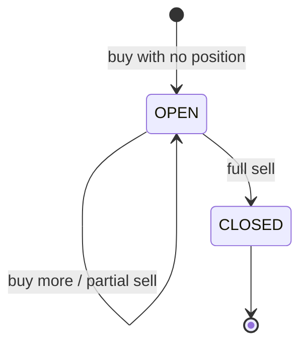

- A new buy after a close opens a new position.
- While a position is open, its MAE and MFE are updated on every price update. They feed the position review (§9).
- **Unrealised P&L and portfolio value** (cash + Σ quantity × latest price) use the broker's `TickerPriceReader`.
- **Money:** all amounts and quantities use `BigDecimal`.

## 9. Bot and run lifecycle (planned)

### Bot states

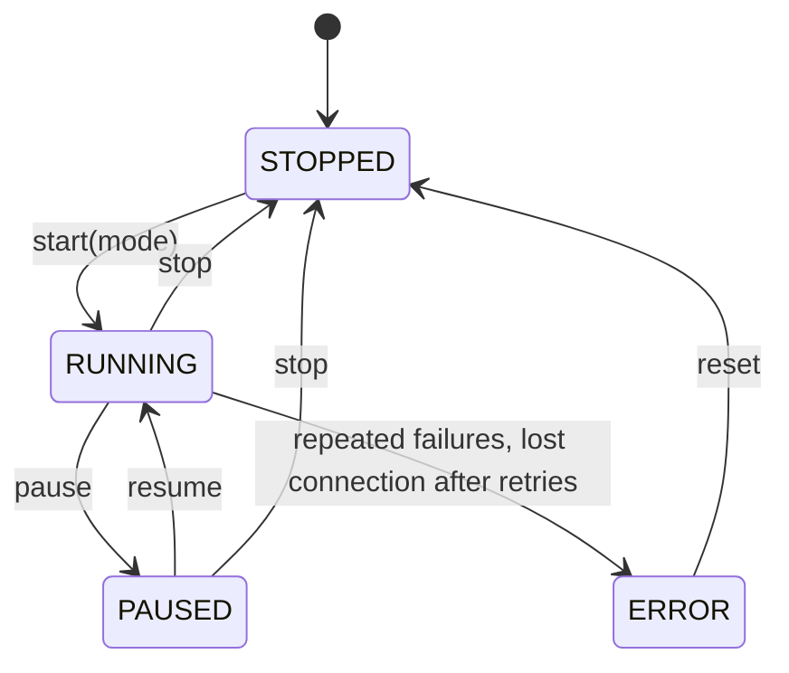

| Control | Allowed from | Effect |
|---|---|---|
| `start(mode, options)` | `STOPPED` | Creates a run and starts the feed |
| `pause` | `RUNNING` | Stops processing. Live updates arriving while paused are dropped |
| `resume` | `PAUSED` | Continues processing |
| `stop` | `RUNNING`, `PAUSED` | Ends the run |
| `reset` | any | Stops and restores the starting balance. A new run is created on the next start |
| switch mode | `STOPPED`, `PAUSED` | Stops the current run and starts one in the other mode |

### Run states

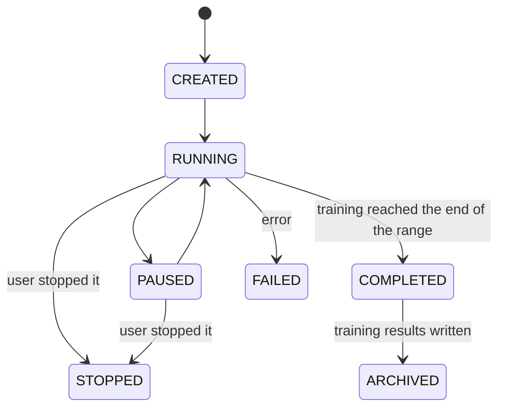

### Training options

Both options replay **as fast as possible**. A backtest over 1.5 years takes minutes, not 1.5 years.
- **Archived (the default):** keeps everything in memory, and writes all trades and snapshots in one transaction when the run completes. The results are viewable afterwards.
- **`live`:** the run is observable while it's in progress. Every trade is written immediately, and progress is pushed to the dashboard as it happens (see §12):
  - progress: the simulated time reached and the % of the range done
  - the portfolio value chart, growing as the run advances
  - the trades appearing in the history table and on the price chart
  - the current top 10 worst positions (see Position review below), updated as positions close

### Position review (both modes)

- Every closed position is kept as a **position record**:
  - entry and exit trades, with their times and prices
  - realised P&L (absolute and %) and duration
  - **MAE** (maximum adverse excursion: the worst unrealised loss while it was open)
  - **MFE** (maximum favourable excursion: the best unrealised profit while it was open)
- **Top 10 worst positions:** closed positions ranked by realised P&L. Each one can be opened as a chart showing:
  - the price path from a little before the entry to a little after the exit, from the candle cache
  - the entry and exit points marked
  - the MAE and MFE points marked

  This shows where the bot entered, where it sold, what happened in between, and what it could have done instead.

## 10. Concurrency

**Built (market data):**
- One WebSocket thread per connection: parses, updates the price map, offers to the queue. Never blocks.
- One dispatcher thread per feeder: delivers `CandleUpdate`s to listeners in arrival order.
- One shared scheduler thread for reconnects.
- The price map is lock-free (`AtomicReference` per ticker); readers on any thread see whole quotes.

**Planned (bot):**
- **Events:** the `PriorityBlockingQueue` is ordered by **execution time**, the moment each event should be processed.
- **First version:** a single worker thread processes events in order. Every order is validated against the latest account state.
- **Later:** a multi-threaded `TradingBotService`:
  - **In parallel:** signal generation, per ticker.
  - **Serialised:** account changes go through a single applier in execution-time order, so the shared cash balance can't be spent twice.
  - **Results:** they depend only on the execution-time order, never on thread timing.
- **Other threads:** the WebSocket callbacks, the REST controls and the REST reads only touch the queue, the bot state, or concurrent and read-only views.

## 11. Persistence (planned)

- **Database:** a relational database, accessed with raw SQL through Spring's `JdbcClient`, with no ORM. The schema is created by SQL scripts in `backend/src/main/resources/db/`.
- **Tables:**

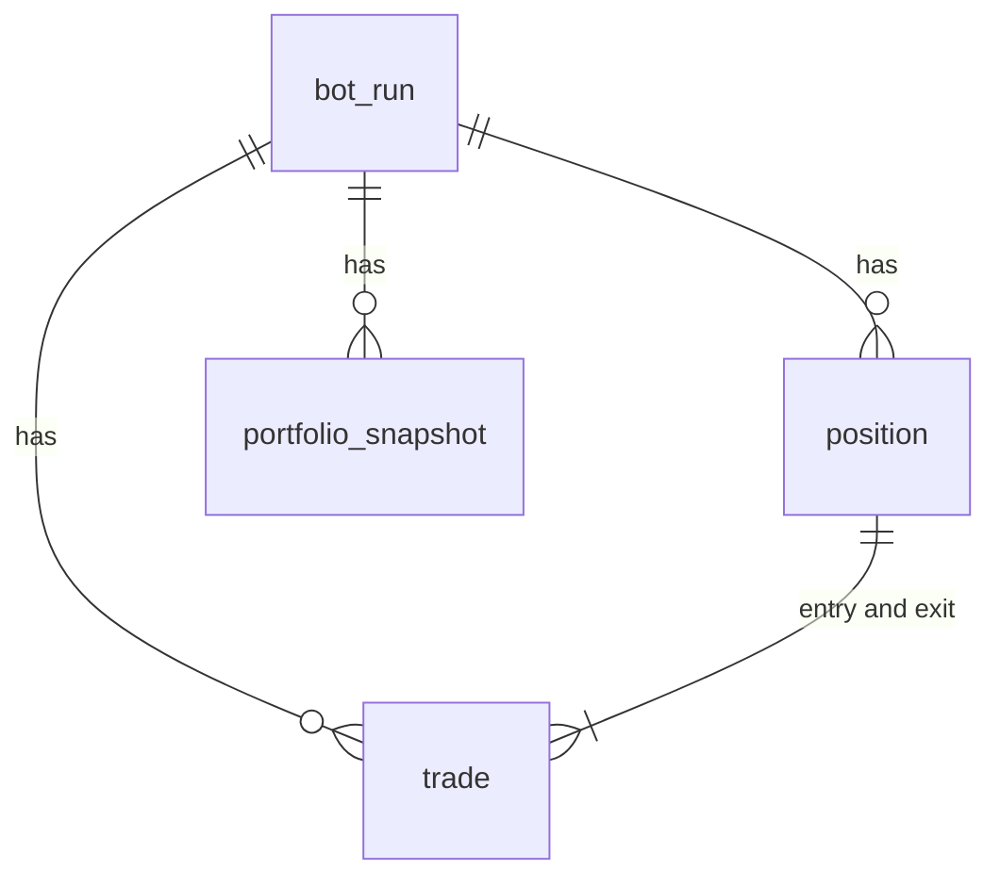

| Table | Contents |
|---|---|
| `bot_run` | id, input hash, mode, symbol, interval, date range, generator and its parameters, starting balance, fee rates, status, timestamps |
| `trade` | deterministic id, run id, sequence, execution time, side, symbol, quantity, price, fee, fee asset, realised P&L |
| `position` | id, run id, symbol, status, quantity, average entry price, opened and closed time, realised P&L, MAE, MFE |
| `portfolio_snapshot` | run id, time, cash, holdings value, total value |
| `candle` | symbol, interval, open time, OHLCV (historical data cache) |

**Write policy:**
- **Trading and live training:** each trade and its position change are written in **one transaction** before the next event is processed, so a crash never loses a confirmed trade. Snapshots are written in batches, and always on pause, stop and reset. They can be rebuilt from trades and candles.
- **Archived training:** everything is written once, at completion.

**Idempotency:**
- **Training:**
  - A run is identified by a hash of its inputs: mode, symbol, interval, date range, generator and parameters, starting balance and fee rates.
  - Processing is deterministic and uses cached candles, so identical inputs always give identical trades.
  - Re-running replaces the archived run instead of duplicating it.
- **Trading:**
  - Trades and events have deterministic ids (run id, execution time, sequence).
  - Unique constraints, plus inserts that ignore conflicts, mean a WebSocket reconnect that re-sends updates never creates duplicate trades.

## 12. REST API (planned)

Everything is under `/api`.

| Method | Path | Purpose |
|---|---|---|
| GET | `/bot/status` | State, mode, current run, latest price |
| POST | `/bot/start` | `{ "mode": "TRAINING", "from": …, "to": …, "live": false }` |
| POST | `/bot/pause`, `/bot/resume`, `/bot/stop`, `/bot/reset` | Controls |
| GET | `/runs`, `/runs/{id}` | Runs and their results |
| GET | `/runs/{id}/trades` | Trade history: date, action, quantity, price, P&L |
| GET | `/runs/{id}/portfolio` | Current cash, positions and total value |
| GET | `/runs/{id}/portfolio/history` | Portfolio value over time |
| GET | `/runs/{id}/candles` | Price chart data, with trades marked on it |
| GET | `/runs/{id}/positions/worst?limit=10` | The worst closed positions, with P&L, MAE, MFE and duration |
| GET | `/runs/{id}/positions/{positionId}/chart` | The price path around one position, with the entry, exit, MAE and MFE marked |
| GET | `/runs/{id}/events` | Server-Sent Events stream of progress, trades, snapshots and position closes, for live training and trading |

## 13. Configuration

Everything goes in `backend/src/main/resources/application.yaml`. Current settings:

```yaml
binance:
  name: binance                               # broker name in the registry
  stream-url: wss://data-stream.binance.vision
  rest-url: https://data-api.binance.vision
  interval: ONE_MINUTE                        # ONE_SECOND … ONE_DAY
  tickers:                                    # at least one
    - BTCUSDT
    - ETHUSDT

smoke:
  duration: 30s                               # how long the smoke run streams
```

Planned additions: starting balance, the active signal generator and its parameters, and the default training range.

The optional read-only API key (for exact fee rates) will be set through the environment variables `BINANCE_API_KEY` and `BINANCE_API_SECRET`.

## 14. Package layout

Built packages are listed with their classes; the rest are planned.

```
com.tihomir.t212.tradingbot
├── broker           Broker, AbstractBroker, BrokerRegistryService
│   └── binance      BinanceBroker, BinanceConnectionProperties, BinanceMarketDataProtocol
├── marketdata
│   ├── update       MarketDataEvent, CandleUpdate, BidAskUpdate, CandleInterval
│   ├── tickerprice  TickerPriceMap, TickerPriceReader, TickerPriceWriter, TickerQuote, TickerQuoteSource
│   ├── candlefeed   CandleFeeder, CandleUpdateListener, ExchangeMarketDataProtocol
│   └── websocket    MarketDataStreamConnection, MarketDataStreamConnectionFactory, MarketDataMessageHandler,
│                    JdkWebSocketConnection, JdkWebSocketConnectionFactory
├── smoke            MarketDataSmokeRunner (profile "smoke")
├── bot              (planned) BotMode, BotState, TradingBotService, BotRun, RunStatus
├── signal           (planned) SignalGenerator, Signal, SignalContext
│   └── indicator    (planned) SMA, EMA, RSI, ...
├── order            (planned) OrderRequest, OrderStatus, RejectionReason, OrderValidator,
│                    OrderExecutionService, ExecutedOrder
│   └── fee          (planned) FeeService
├── account          (planned) AccountService, Position, PositionStatus, PortfolioSnapshot
├── persistence      (planned) repositories (JdbcClient)
└── api              (planned) REST controllers and DTOs
```
