# Architecture

## 1. Overview

The application simulates an autonomous crypto trading bot. It reads market data from Binance, generates trading signals and executes orders. Orders go either to a virtual account (Training) or to a **Binance Demo Mode** account with fake funds. Nothing is ever sent to a live trading account; the configuration refuses any trading URL that does not point to the configured demo host (`demo-api.binance.com`).

| Mode | Data source | Purpose |
|---|---|---|
| `TRAINING` (backtest) | Historical Binance data (REST) | Run the bot over a past period to analyse it |
| `TRADING` (live-sim) | Live Binance streams (WebSocket) | Run the bot on live prices |

Both modes run **the same pipeline and the same logic**. Only the source of events differs. No look-ahead: an event only ever sees the data the candle feed has delivered up to that event's execution time.

### Status

| Part | Status |
|---|---|
| Market data: brokers, candle feeder, WebSocket streams, REST history, ticker price map | **Built** |
| Demo account orders: signed market orders and balances on Binance Demo Mode, REST endpoints | **Built** |
| Candle store: ticker and candle tables, paged download (§16.1) | In progress |
| Trading algorithm with required and optional settings, SMA example (§16.2) | In progress |
| Order checks, virtual account for training (§16.3) | In progress |
| Recorded runs and settings (start, change, end), training runs (§16.4, §16.5) | In progress |
| Live bot: `TradingBotService`, `currentParameters`, editing (§16.5, §16.6) | In progress |
| Database: PostgreSQL + Flyway, raw SQL. Orders: open orders, order history, fills | **Built** |
| Database: restart reconciliation, positions (FIFO lots), trades with PnL | Planned, next |
| React dashboard: tickers, holdings, orders, mode switch, light and dark theme | **Built** (§15) |
| Dashboard: live bot, training and runs tabs, settings forms, charts, following tickers (§15.1, §15.2) | In progress |
| Rest of the REST API (bot controls, runs, charts) | Planned |

### System overview

Solid boxes are built; dashed boxes are planned.

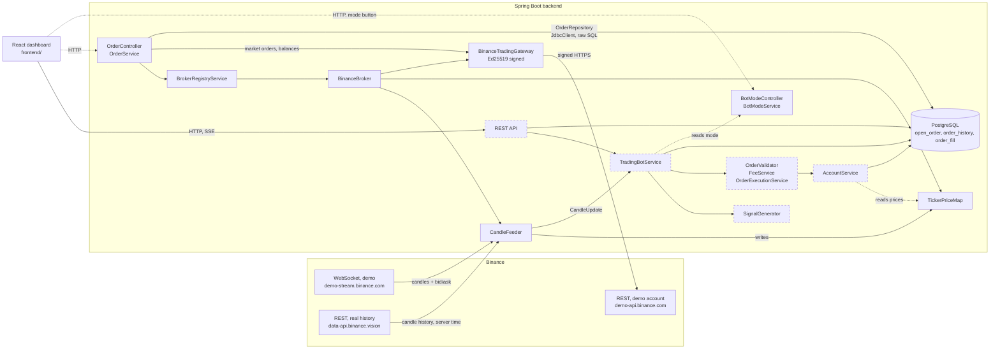

## 2. Components

| Component | Status | Responsibility |
|---|---|---|
| `Broker` | Built | One exchange: name, tickers, candle feeder and ticker price map. `AbstractBroker` is the abstract factory; `BinanceBroker` is the first implementation. One singleton per exchange |
| `BrokerRegistryService` | Built | Holds every broker by name, so several brokers can run at once. Rejects duplicate names |
| `CandleFeeder` | Built | One shared class for all brokers: WebSocket connections, grouping streams by connection, history paging, exchange clock offset. Writes the broker's ticker price map and hands `CandleUpdate`s to listeners. Never touches the account |
| `ExchangeMarketDataProtocol` | Built | The exchange-specific part of market data: stream names, URLs, limits, message parsing |
| `MarketDataStreamConnection` | Built | One WebSocket connection with a fixed 5-second reconnect (`JdkWebSocketConnection`) |
| `TickerPriceMap` | Built | Latest quote per ticker, per broker. Written by the candle feeder (`TickerPriceWriter`), read by everyone else (`TickerPriceReader`) |
| `ExchangeTradingGateway` | Built | The exchange-specific part of trading: place a market order, read balances. `BinanceTradingGateway` is a singleton Spring bean, injected into `BinanceBroker`. Its Binance JSON mapping lives in `broker.binance.util.OrderUtil` |
| `RequestSigner` | Built | Signs a request's query string. `BinanceRequestSigner` uses Ed25519. Without an API key, `MissingKeyRequestSigner` is used instead and refuses every signed request, so trading is off |
| `BalanceCachingTradingGateway` | Built | Wraps a broker's trading gateway and answers balance reads from its `AccountBalanceCache`, so they send no request (§7.2) |
| `BinanceUserDataStream` | Built | Binance's user data stream, on its own WebSocket connection (`userdata` package). Applies `outboundAccountPosition` balance events to the cache, and has `AccountBalanceSynchronizer` take a snapshot after each subscription and every 15 minutes (§7.2) |
| `OrderService` | Built | Finds the broker, checks the ticker is one it trades, sends the order to the broker's trading gateway, then stores the result in `order_history` or `rejected_order` (§7.1, §11) |
| `OrderController` | Built | `POST /api/brokers/{broker}/orders` and `GET /api/brokers/{broker}/balance`. `ApiExceptionHandler` turns failures into HTTP problem responses |
| `BotModeService` | Built | The current `BotMode` (`TRADING` or `TRAINING`). Switched at runtime, without a restart, through `PUT /api/bot/mode` |
| `TradingBotService` | Planned | Owns the event loop, the bot state and the runs |
| `SignalGenerator` | Planned | Interface for trading logic, with several implementations chosen by config. Returns `Buy`, `Sell` or `Hold` |
| `OrderValidator` | Planned | Turns a signal into a valid `OrderRequest`, or rejects it |
| `FeeService` | Planned | Provides fee rates (exact Binance rates with an API key, the standard schedule otherwise) and calculates fees |
| `OrderExecutionService` | Planned | Fills a valid `OrderRequest` and produces an `ExecutedOrder`. No validation or fee logic |
| `AccountService` | Planned | Applies `ExecutedOrder`s to cash and positions, and calculates P&L and portfolio value |
| `OrderRepository` | Built | PostgreSQL access for the order tables (`JdbcClient`, raw SQL, no ORM). Implements `OrderStore`, so `OrderService` doesn't depend on the database code |
| Other repositories | Planned | Lots, trades, candles, runs |
| REST API | Planned | Controls and read endpoints for the React dashboard |

Components exchange immutable DTOs (Java records): `CandleUpdate`, `BidAskUpdate`, `Signal`, `OrderRequest`, `ExecutedOrder`, `TradeHistoryEntry`, `PortfolioSnapshot`.

## 3. Event pipeline (planned)

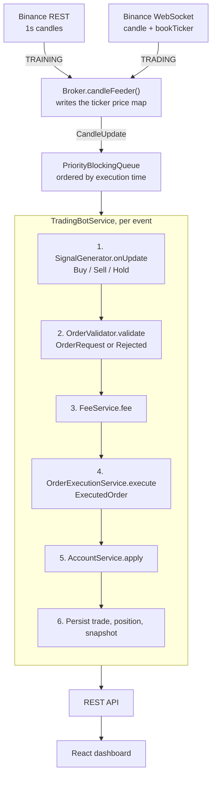

## 4. Market data (built)

### 4.1 Brokers

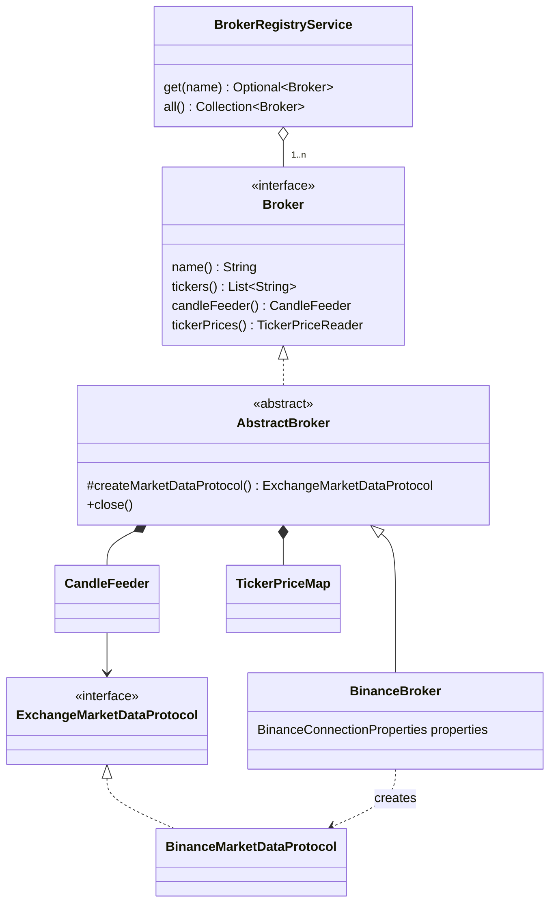

- Every broker is a Spring singleton. The registry fails at startup if two brokers share a name.
- Each broker *has* a `CandleFeeder` (composition), built on the first call to `candleFeeder()`. The feeder logic is shared; only the `ExchangeMarketDataProtocol` differs per exchange.
- `BinanceBroker` reads its settings from `binance.*` in `application.yaml` (`BinanceConnectionProperties`). Startup fails if no tickers are configured.
- Planned: a portfolio per broker, transfers between brokers (which take time), and an `OrderGateway` factory method. Orders go to the Binance Spot Testnet first, then to real Binance's validate-only `POST /api/v3/order/test`.

### 4.2 Live data flow

Three kinds of threads touch market data. The WebSocket thread does only quick work, so it can ask for the next message straight away.

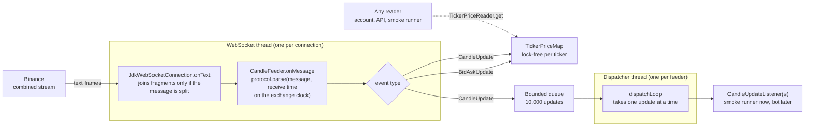

1. A text frame arrives. A message that arrives in one piece is handed on directly; a split message is collected and the buffer is released afterwards.
2. `ExchangeMarketDataProtocol.parse` turns it into a `CandleUpdate`, a `BidAskUpdate`, or nothing (for example a subscription acknowledgement).
3. **`BidAskUpdate`:** updates bid and ask in the price map.
4. **`CandleUpdate`:** updates the last price in the price map and is offered to the queue. If the queue is full the update is dropped with a warning; the socket is never blocked.
5. The connection then asks for the next message (`request(1)` in a `finally`, so a failure never stalls the stream).
6. The dispatcher thread hands each `CandleUpdate` to every listener. A failing listener is logged and the others still run.

### 4.3 Starting a feeder

`start()` is all or nothing: either every connection opens, or everything is closed again and the error is passed on.

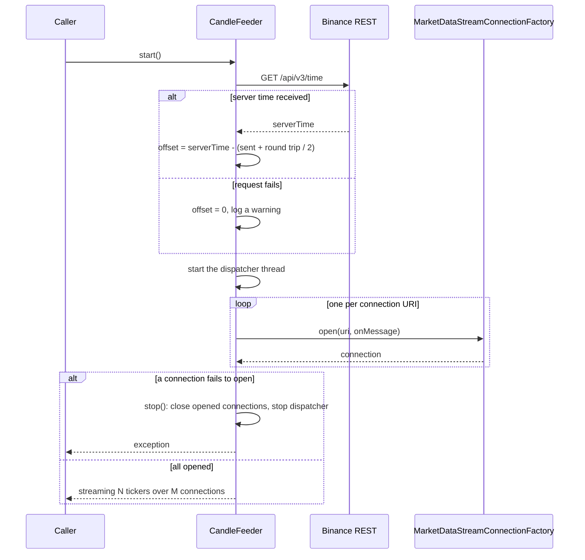

### 4.4 Grouping streams into connections

One connection carries up to 1,024 streams (Binance's limit). Every ticker has 2 streams (candle and bid/ask), and a ticker's streams never get split across connections.

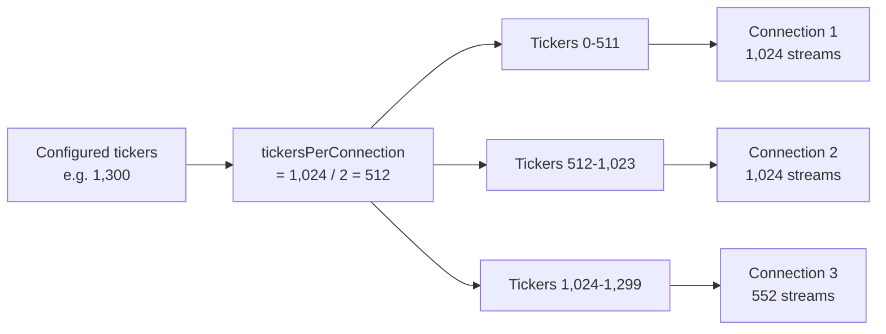

Each connection URI is a combined stream, for example:

```
wss://demo-stream.binance.com/stream?streams=btcusdt@kline_1m/btcusdt@bookTicker/ethusdt@kline_1m/ethusdt@bookTicker
```

With the two default tickers this is a single connection.

### 4.5 Connection lifecycle

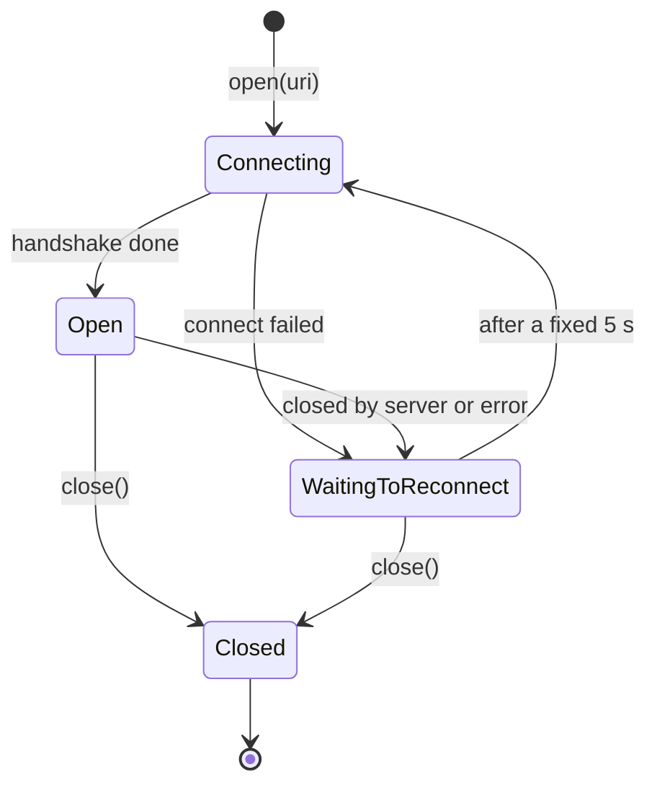

- Pings are answered with pongs. Binance drops every connection after 24 hours; it reconnects like any other drop.
- The fixed 5-second delay stays well under Binance's limit of 300 connection attempts per 5 minutes per IP.
- If the reconnect scheduler is shutting down, no reconnect is scheduled and that is logged.

### 4.6 Candle history over REST

`history(ticker, interval, from, to)` pages `GET /api/v3/klines` (Binance calls candles "klines"), up to 1,000 candles per request.

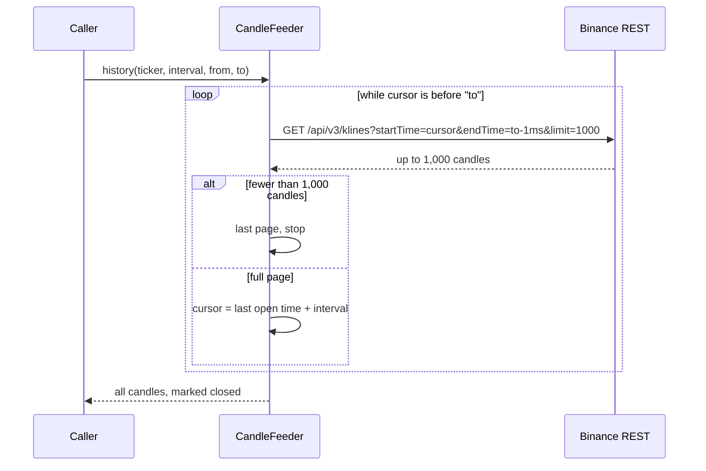

### 4.7 Market data events

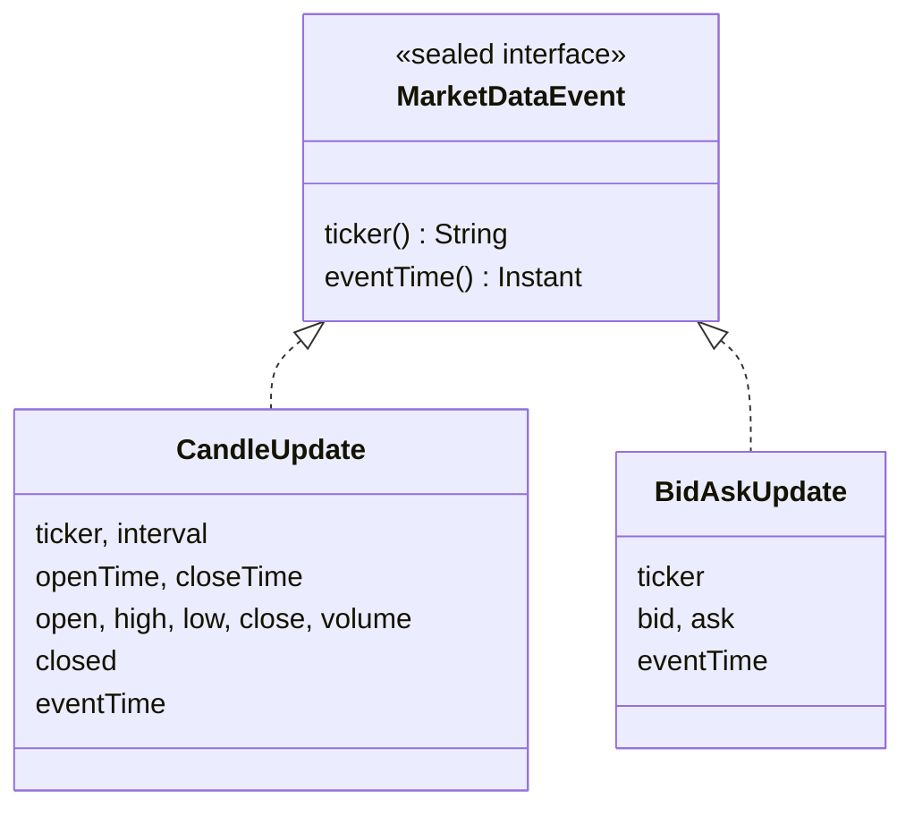

Every event time is on the **exchange's clock**:

| Event | Where `eventTime` comes from |
|---|---|
| Live `CandleUpdate` | Binance's event time (`"E"`) |
| History `CandleUpdate` | The candle's close time |
| `BidAskUpdate` | Binance's spot `@bookTicker` has no event time, so the receive time shifted by the exchange clock offset measured on start |

A `CandleUpdate` is the current state of the forming candle plus `closed`.
- **Trading:** the candle stream sends an update every 1–2 seconds. Each update becomes an event.
- **Training (planned):** the same updates are rebuilt from historical **`1s` candles**. They're aggregated into the forming candle of the chosen interval and emitted one second at a time. A day is about 86,400 `1s` candles, which is 87 requests.
- **Cache (planned):** historical candles are stored in the database after the first download, so re-runs use identical data and don't call Binance again.

### 4.8 Failure handling

| What fails | What happens |
|---|---|
| Unreadable message | Logged as a warning, the stream continues |
| Listener throws | Logged, the other listeners and later updates still run |
| Dispatch queue full | Update dropped with a warning; the price map is still updated |
| Connection drops or errors | Reconnect after a fixed 5 seconds |
| Reconnect itself throws | The next reconnect is scheduled |
| Answering a ping fails | Logged, the stream continues |
| Server time unavailable on start | Local clock used, warning logged |
| A connection fails during `start()` | Everything opened so far is closed and the error is passed on |

### 4.9 Binance endpoints (public, no key needed)

Live streams come from the **demo** stream host, so the price map shows the prices that demo orders fill at. Candle history comes from **real** Binance data, so Training learns on real prices.

| Endpoint | Used for |
|---|---|
| `wss://demo-stream.binance.com/stream?streams=…` | `<symbol>@kline_<interval>` candles and `<symbol>@bookTicker` best bid/ask, JDK `java.net.http.WebSocket` |
| `GET /api/v3/klines` on `data-api.binance.vision` | Candle history, 1,000 per request |
| `GET /api/v3/time` | Exchange clock offset |
| `GET /api/v3/exchangeInfo` (planned) | Trading rules per symbol: minimum quantity, step size, minimum order value |

## 5. Ticker price map (built)

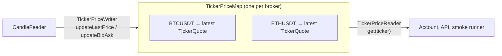

Each broker has a `TickerPriceMap`: its configured tickers mapped to the latest `TickerQuote` (bid, ask, last price, update time, source).
- The key set is fixed at startup. Each value starts **empty** and is filled only by a valid REST fetch or a WebSocket message for that ticker. Updates for other tickers are ignored.
- Values are `AtomicReference<TickerQuote>`s, so updates are lock-free and readers never see a half-written quote.
- A candle update sets the last price; a bid/ask update sets bid and ask. Each keeps the other's fields.
- **`TickerPriceWriter`:** only the broker's `CandleFeeder` receives it.
- **`TickerPriceReader`:** every other component receives it. Read-only by type.
- **Training mode (planned):** the feeder must not run ahead of the bot, so in Training it releases events one at a time and writes each price only as it releases that event. The map never shows a "future" price.

## 6. Signals (planned)

> Superseded by §16.2: a `TradingAlgorithm` produces the signals and `OrderCheckerService` decides on the order (§16.3). The table below is the original idea.

`SignalGenerator.onUpdate(CandleUpdate, SignalContext)` runs on **every candle update** in both modes. `SignalContext` gives read-only access to recent candles, indicators, the open position and the cash balance.

| Signal | Parameters | Meaning |
|---|---|---|
| `Buy` | size (quantity or quote amount) | Open or add to a position |
| `Sell` | size (quantity, or all) | Reduce or close a position |
| `Hold` | none | Do nothing |

Indicators (SMA, EMA, RSI, …) are separate, reusable classes under `signal/indicator`.

## 7. Orders

### 7.1 Demo account orders (built)

Real market orders go to a **Binance Demo Mode** account: fake funds, with the same features and trading rules as the live exchange. For now they are placed by hand through the REST API. The bot will use the same `OrderService` later.


**Request:**

| Field | Values | Binance parameter |
|---|---|---|
| `ticker` | one of the broker's configured tickers | `symbol` |
| `side` | `BUY`, `SELL` | `side` |
| `amount` | greater than zero | |
| `amountType` | `QUOTE_AMOUNT`: spend or receive this much USDT | `quoteOrderQty` |
| | `BASE_QUANTITY`: buy or sell this much of the coin | `quantity` |

**Order ids:** Binance's `orderId` is the primary key of every live order table. `placeMarketOrder` takes no id. The Binance gateway sends its own `newClientOrderId` (`tb-` plus a random UUID) only to mark the order as the bot's, so orders placed by hand on the website can be told apart. Training mode will create its own ids inside its virtual gateway.

Nothing is written before sending: an order is stored once Binance answers.

**Outcomes:**

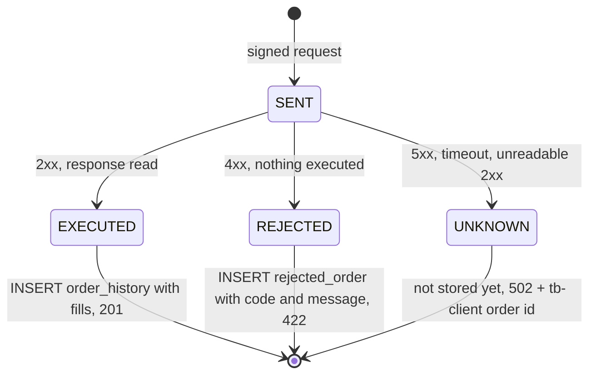

- **Unknown outcome:** Binance may still have executed it. The planned reconciliation step records it from the user data stream's `executionReport` (which carries Binance's `orderId`) or from a startup check of the bot's recent `tb-` orders.
- **Database fails after execution:** the answer is still 201 and the error is logged. The same reconciliation step fills the gap.

| Where the order is | Status |
|---|---|
| `open_order` (only active orders) | Orders Binance acknowledged that still rest on the book (`NEW`, `PARTIALLY_FILLED`). Market orders never stay open; this fills up once take-profit and stop-loss orders exist |
| `order_history` (append-only) | Executed: Binance's final status (`FILLED`, `EXPIRED`, …), with fills |
| `rejected_order` (append-only) | Refused by Binance: its error code and message |

| Failure | Example | HTTP |
|---|---|---|
| Binance refused the order | `-2010` insufficient balance, `-1013` `LOT_SIZE` / `NOTIONAL` filter, `-1021` timestamp outside `recvWindow`, `-2015` bad key | 422, with `exchangeErrorCode` |
| No answer, or a server error | timeout, connection reset, 5xx. Binance may still have executed it | 502, with `clientOrderId` |
| Balances unreachable | timeout, 5xx | 502 |
| Unreadable request body, or an amount of zero or less | | 400 |

**Safety:**
- `BinanceTradingProperties` refuses to start unless `binance.trading.rest-url` points to `binance.trading.demo-host` (`demo-api.binance.com`). `BinanceUserDataStreamProperties` does the same for the user data stream (`demo-ws-api.binance.com`).
- The API key and the path to the Ed25519 private key come only from the environment variables `BINANCE_DEMO_API_KEY` and `BINANCE_DEMO_PRIVATE_KEY_PATH`. Without them, `BinanceTradingConfiguration` provides a `MissingKeyRequestSigner`: nothing is sent to Binance and the order and balance endpoints answer 409.
- `GET /api/brokers/{broker}/balance` answers `{"balances": [{"asset", "free", "locked"}, …]}`, non-zero balances only.
- A key file that can't be read stops the application at startup.
- Timestamps use the local clock. Binance accepts requests that arrive within `recv-window` (5 seconds) of it.

**Not covered yet:** rounding quantities to the symbol's step size and checking the minimum order value (via `exchangeInfo`). Binance rejects such orders with a filter failure, which comes back as a 422. Orders left `SENDING` or `UNKNOWN` in `open_order` are settled from Binance by the reconciliation step that comes next (§11).

### 7.2 Account balances: cache and user data stream (built)

To send as few requests to Binance as possible, balances are never read from Binance per request. `BalanceCachingTradingGateway` keeps them in an `AccountBalanceCache`, and Binance's **user data stream** keeps that cache in sync. Binance is the source of truth: the cache only ever holds numbers Binance sent, never values computed from what an order was expected to do.

The user data stream has its own connection, separate from the market data streams, because Binance separates them too: a different host (`demo-ws-api.binance.com`, the WebSocket API), a signed subscription and private account data. The `userdata` package has its own `UserDataStreamConnection`, with a fixed 5-second reconnect.

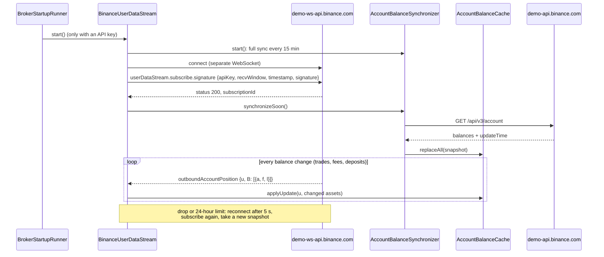

| Source | When | Requests |
|---|---|---|
| Snapshot | after every successful subscription (startup and each reconnect) | 1 |
| `outboundAccountPosition` event | every balance change. It carries absolute `free`/`locked` values for the changed assets only | 0 |
| Safety sync | every `balance-sync-interval` (15 min), fixed rate | 1 |
| `GET /balance` | answered from the cache. Only an empty cache loads a snapshot | 0 |
| Executed order | the stream reports the new balances | 0 |
| Order with unknown status | the cache is cleared and reloaded on the next read | 0 now, 1 later |

**Ordering:** every cached asset remembers the update time it came with (`u` for events, `updateTime` for snapshots). An event or snapshot older than what is cached for that asset is ignored. A snapshot drops assets it no longer lists unless the cache has a newer event for them. Events that arrive before the first snapshot are kept and merged.

**Failures:**
- **Failed sync:** logged, then retried **once** after `balance-sync-retry-delay` (10 seconds). If the retry fails too, it's logged and the next regular sync runs on its usual 15-minute schedule. The retry never moves that schedule.
- **Stream drops:** events sent while disconnected are lost, because Binance doesn't replay them. The reconnect therefore subscribes again and takes a new snapshot.
- **Subscription refused** (e.g. `-2015`): logged. The safety sync still keeps the cache correct.
- **`eventStreamTerminated`:** subscribe again on the same connection.
- **Unreadable messages:** logged and skipped. The stream keeps reading.
- **No API key:** the stream and the sync don't start, and the endpoints answer 409.

`executionReport` events (one per order update, keyed by `clientOrderId`) are logged for now. A later step can use them to settle orders whose REST answer timed out (status unknown).

### 7.3 Order lifecycle in the bot (planned, first version: market orders only)

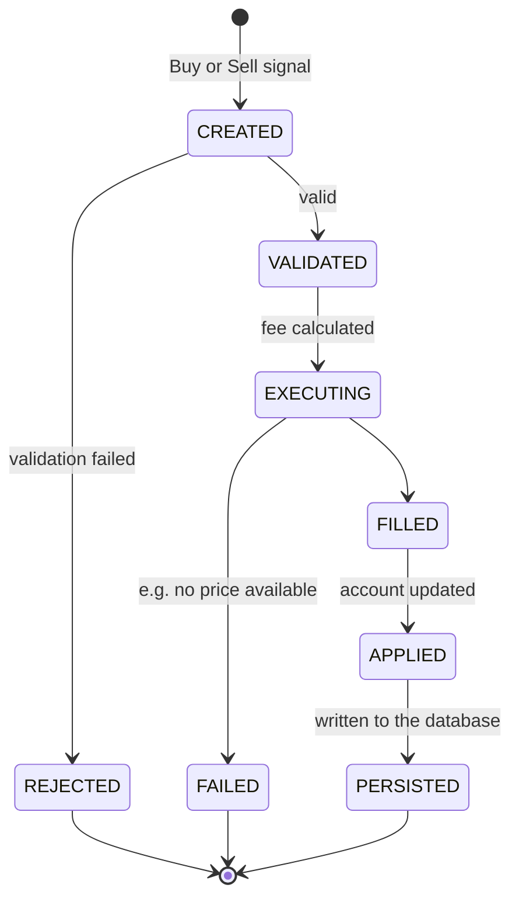

| State | Set by | Meaning |
|---|---|---|
| `CREATED` | `TradingBotService` | Built from a `Buy` or `Sell` signal |
| `VALIDATED` | `OrderValidator` | Passed all checks |
| `REJECTED` | `OrderValidator` | Failed a check, with a reason. Logged and kept for the dashboard |
| `EXECUTING` | `OrderExecutionService` | Fill in progress |
| `FILLED` | `OrderExecutionService` | Price and quantity are final |
| `FAILED` | `OrderExecutionService` | Couldn't be filled. The bot goes to `ERROR` if it repeats |
| `APPLIED` | `AccountService` | Cash and position updated |
| `PERSISTED` | Repository | Saved. Only now is the next event allowed to depend on it |

**Rejection reasons:**
- `INSUFFICIENT_FUNDS`
- `INSUFFICIENT_HOLDINGS` (selling more than is held)
- `NO_POSITION` (selling with nothing open)
- `BELOW_MIN_QUANTITY` / `BELOW_MIN_NOTIONAL` (Binance `exchangeInfo` rules)
- `BOT_NOT_RUNNING`

Quantities are rounded down to the symbol's step size before validation.

### 7.4 Fill price

| Mode | Buy | Sell |
|---|---|---|
| `TRADING` | Best **ask** at the moment of the signal (`bookTicker`) | Best **bid** |
| `TRAINING` | Open of the next `1s` candle after the signal | Same |

### 7.5 Fees

`FeeService` uses the exact rates from Binance's signed `GET /api/v3/account/commission` when a **read-only** API key is configured. The key comes from environment variables and is never committed. Without a key, it uses the standard schedule: 0.1% maker and 0.1% taker.
- Market orders pay the taker rate.
- The fee is charged in the received asset: the base coin on a buy, the quote coin on a sell.
- Rates are cached and refreshed periodically. Calculating a fee is a direct call.

### 7.6 Later order types

These plug into the same lifecycle:
- `LIMIT`, `STOP_LOSS` and `TAKE_PROFIT` orders, plus their `*_LIMIT` variants.
- OCO brackets and trailing stops.
- Time in force (`GTC`, `IOC`, `FOK`).

They add a `PENDING` state, held in an in-memory open-orders book and checked on every update:

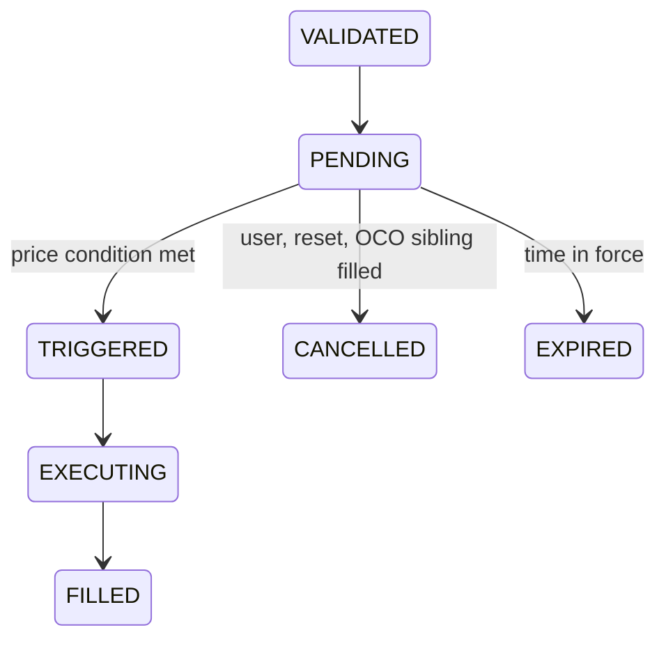

## 8. Account and positions (planned)

- The account has a cash balance in the quote currency (e.g. USDT), plus one position per ticker (quantity and average entry price).
- `AccountService.apply(ExecutedOrder)` follows these rules:
  - **Buy, no position:** opens a position. Cash decreases by price × quantity, and the fee is taken from the coin received.
  - **Buy, existing position:** adds the quantity and recalculates the average entry price.
  - **Sell, partial:** reduces the quantity. Realised P&L = (price − average entry) × quantity − fee.
  - **Sell, full:** closes the position, with the same P&L calculation.

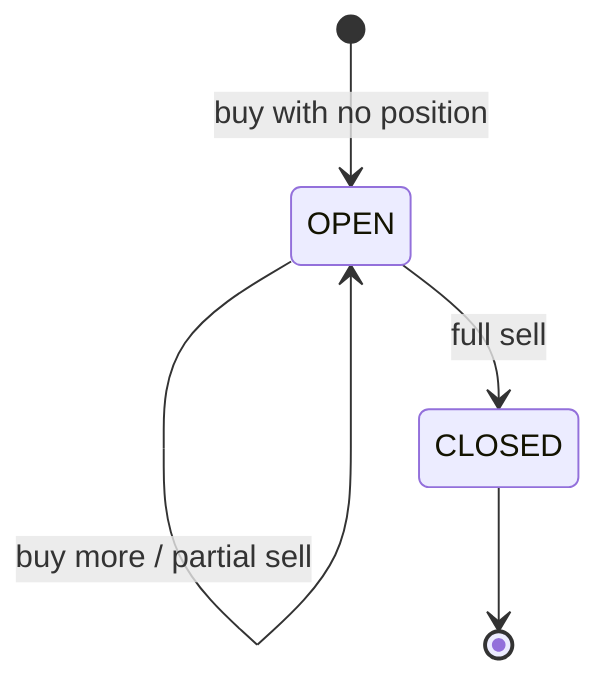

- A new buy after a close opens a new position.
- While a position is open, its MAE and MFE are updated on every price update. They feed the position review (§9).
- **Unrealised P&L and portfolio value** (cash + Σ quantity × latest price) use the broker's `TickerPriceReader`.
- **Money:** all amounts and quantities use `BigDecimal`.

## 9. Bot and run lifecycle (planned)

### Bot mode (built)

The bot mode is application state, not a Spring profile, so it can be switched with one button without restarting the application. `bot.mode` in `application.yaml` sets the mode at startup; `BotModeService` holds it after that.

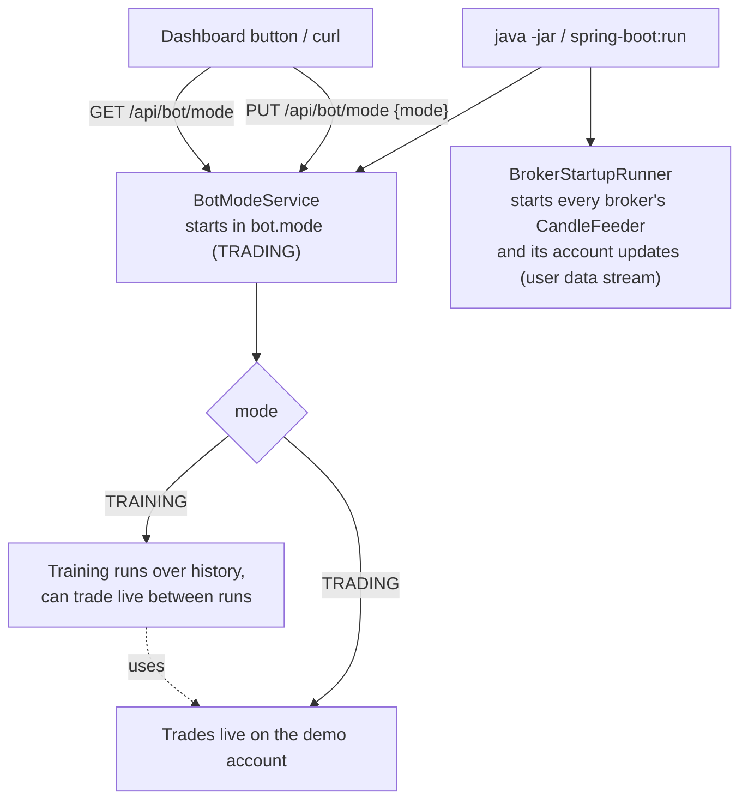

- **Training uses trading, not the other way around.** A training session iterates over several training runs and can trade live in between, so the live streams and the trading gateway are available in both modes. Live streams always start at startup.
- Switching only changes the stored mode for now. Once `TradingBotService` exists, it reads the mode to decide what to run.
- The only remaining profile is `smoke`: `MarketDataSmokeRunner` streams for `smoke.duration`, logs what it receives, then shuts the application down.
- The application context test replaces `BrokerStartupRunner` with a mock, so tests never open a network connection.

> The live bot and recorded runs are described in §16.5 and §16.4; pause, resume and reset below are not part of that first version.

### Bot states

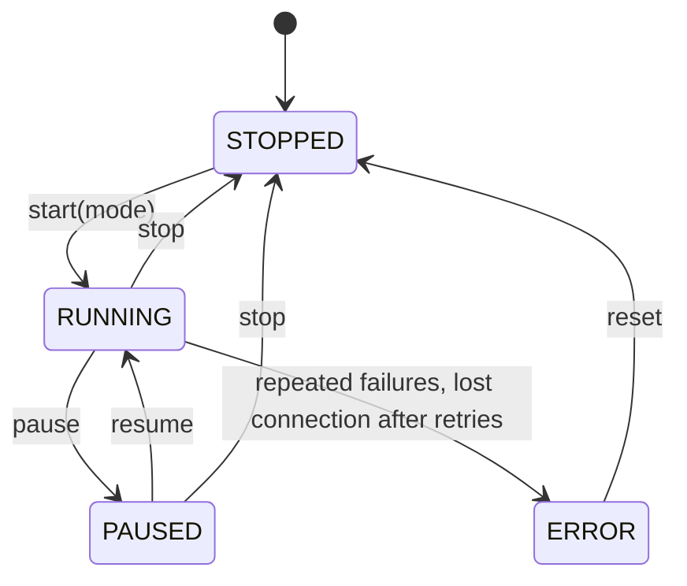

| Control | Allowed from | Effect |
|---|---|---|
| `start(mode, options)` | `STOPPED` | Creates a run and starts the feed |
| `pause` | `RUNNING` | Stops processing. Live updates arriving while paused are dropped |
| `resume` | `PAUSED` | Continues processing |
| `stop` | `RUNNING`, `PAUSED` | Ends the run |
| `reset` | any | Stops and restores the starting balance. A new run is created on the next start |
| switch mode | `STOPPED`, `PAUSED` | Stops the current run and starts one in the other mode |

### Run states

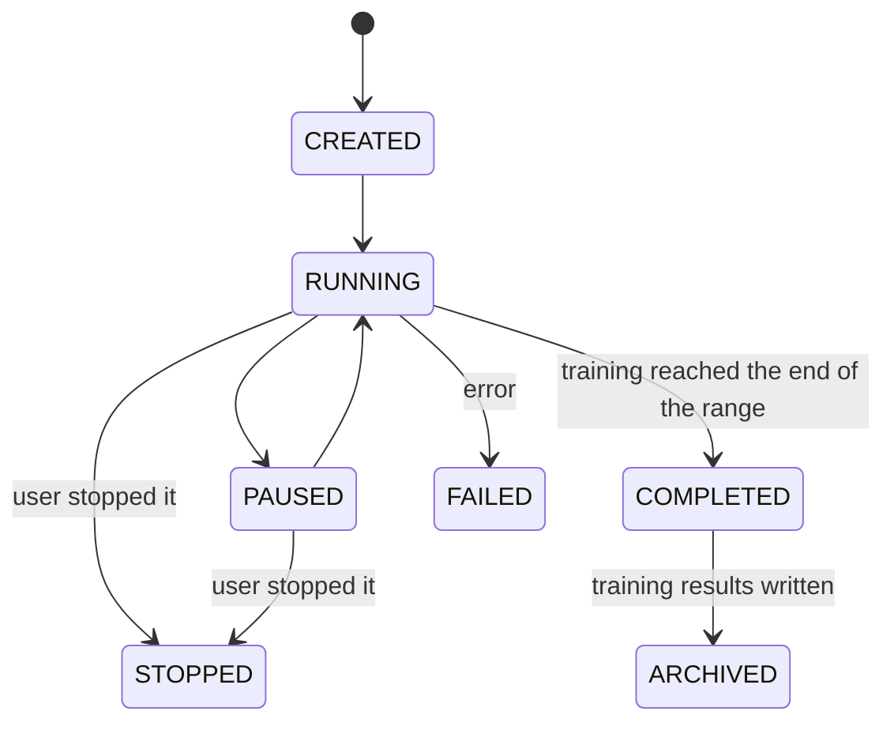

### Training options

Both options replay **as fast as possible**. A backtest over 1.5 years takes minutes, not 1.5 years.
- **Archived (the default):** keeps everything in memory, and writes all trades and snapshots in one transaction when the run completes. The results are viewable afterwards.
- **`live`:** the run is observable while it's in progress. Every trade is written immediately, and progress is pushed to the dashboard as it happens (see §12):
  - progress: the simulated time reached and the % of the range done
  - the portfolio value chart, growing as the run advances
  - the trades appearing in the history table and on the price chart
  - the current top 10 worst positions (see Position review below), updated as positions close

### Position review (both modes)

- Every closed position is kept as a **position record**:
  - entry and exit trades, with their times and prices
  - realised P&L (absolute and %) and duration
  - **MAE** (maximum adverse excursion: the worst unrealised loss while it was open)
  - **MFE** (maximum favourable excursion: the best unrealised profit while it was open)
- **Top 10 worst positions:** closed positions ranked by realised P&L. Each one can be opened as a chart showing:
  - the price path from a little before the entry to a little after the exit, from the candle cache
  - the entry and exit points marked
  - the MAE and MFE points marked

  This shows where the bot entered, where it sold, what happened in between, and what it could have done instead.

## 10. Concurrency

**Built (market data):**
- One WebSocket thread per connection: parses, updates the price map, offers to the queue. Never blocks.
- One dispatcher thread per feeder: delivers `CandleUpdate`s to listeners in arrival order.
- One shared scheduler thread for reconnects.
- The price map is lock-free (`AtomicReference` per ticker); readers on any thread see whole quotes.

**Planned (bot):**
- **Events:** the `PriorityBlockingQueue` is ordered by **execution time**, the moment each event should be processed.
- **First version:** a single worker thread processes events in order. Every order is validated against the latest account state.
- **Later:** a multi-threaded `TradingBotService`:
  - **In parallel:** signal generation, per ticker.
  - **Serialised:** account changes go through a single applier in execution-time order, so the shared cash balance can't be spent twice.
  - **Results:** they depend only on the execution-time order, never on thread timing.
- **Other threads:** the WebSocket callbacks, the REST controls and the REST reads only touch the queue, the bot state, or concurrent and read-only views.

## 11. Database (orders built, the rest planned)

- **PostgreSQL 17** holds every table. Locally it runs from `backend/compose.yaml` (Docker), which Spring Boot's Docker Compose support starts on `spring-boot:run` and leaves running. Tests use Testcontainers.
- **Flyway** creates and upgrades the tables at startup from numbered raw-SQL scripts in `backend/src/main/resources/db/migration` (`V1__create_order_tables.sql`, …). There's no ORM: the `database` package uses Spring's `JdbcClient` with plain SQL.
- **Rule:** a "current" table holds only active rows; a history table only ever gets rows added. Moving a row from one to the other always happens in **one transaction**.

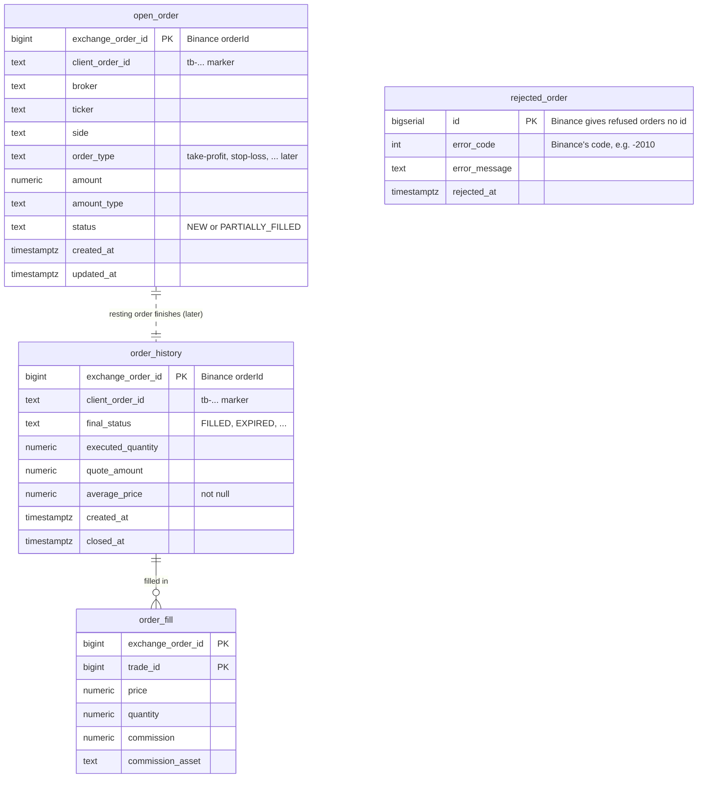

- **Keys:** live orders are keyed by Binance's `orderId` (`V3__key_orders_by_exchange_order_id.sql`). Binance gives a refused order no id, so `rejected_order` has its own `bigserial`.
- `order_history` holds executed orders only and `rejected_order` holds refused orders only, so every column is always set: no nullable execution or error columns, and one fixed shape per list for the dashboard (`V2__split_rejected_orders.sql`).
- Each keeps the order's broker, ticker, side, type and amount.
- Money and quantities are `numeric`, mapped to `BigDecimal`. Times are `timestamptz`.
- **`OrderRepository`:** method names follow the SQL they run: `insertExecutedOrder` (history row plus fills, in **one transaction**), `insertRejectedOrder`, `getOpenOrders`, `getOrderHistory`, `getRejectedOrders`. Each read returns a record holding its list (`OpenOrderList`, `OrderHistory`, `RejectedOrderList`), which the service passes on. The controller wraps each in its own API response DTO (`OpenOrderListResponse`, `OrderHistoryResponse`, `RejectedOrderListResponse`, `AccountBalanceResponse`), so the JSON contract stays separate from the internal records.
- **Idempotent:** inserting the same executed order twice changes nothing: `insertExecutedOrder` first runs `SELECT COUNT(*) FROM order_history WHERE exchange_order_id = ?` and skips an order that is already stored, in the same transaction as the inserts.
- **Plain SQL only:** queries use standard `SELECT`, `INSERT`, `UPDATE`, `DELETE`, `JOIN`, `WHERE`, `ORDER BY` and `LIMIT`, with `?` placeholders. No named parameters and no PostgreSQL-only clauses such as `ON CONFLICT`.
- **Migrations are safe to re-run:** tables and indexes are created with `IF NOT EXISTS`.
- **Failures:**
  - Database fails after Binance executed the order: the answer is still 201 and the error is logged. Reconciliation will fill the gap.
  - A failed insert rolls back completely: no history row and no fills.
  - Database down on a read: 503.
- **Endpoints:** `GET /api/brokers/{broker}/orders/open`, `GET /api/brokers/{broker}/orders/history` (the latest 100 executed orders, with fills) and `GET /api/brokers/{broker}/orders/rejected` (the latest 100 rejected orders).

**Planned next (stacked PRs):**
- **Reconciliation:** `executionReport` events from the user data stream record any bot order (`tb-` client id) missing from the database, keyed by Binance's `orderId`. A startup check of Binance's recent orders covers the time the app was down.
- **Positions and trades:** `open_lot` (current, one row per buy that still holds coins) and `trade` (history: FIFO matches of buy and sell lots with entry/exit price, fees and PnL), written in the same settlement transaction. A position is the sum of its open lots.

**Planned later:**

| Table | Contents |
|---|---|
| `bot_run` | id, input hash, mode, symbol, interval, date range, generator and its parameters, starting balance, fee rates, status, timestamps |
| `portfolio_snapshot` | run id, time, cash, holdings value, total value |
| `candle` | symbol, interval, open time, OHLCV (historical data cache) |

**Write policy:**
- **Trading and live training:** each trade and its position change are written in **one transaction** before the next event is processed, so a crash never loses a confirmed trade. Snapshots are written in batches, and always on pause, stop and reset. They can be rebuilt from trades and candles.
- **Archived training:** everything is written once, at completion.

**Idempotency:**
- **Training:**
  - A run is identified by a hash of its inputs: mode, symbol, interval, date range, generator and parameters, starting balance and fee rates.
  - Processing is deterministic and uses cached candles, so identical inputs always give identical trades.
  - Re-running replaces the archived run instead of duplicating it.
- **Trading:**
  - Trades and events have deterministic ids (run id, execution time, sequence).
  - Unique constraints, plus inserts that ignore conflicts, mean a WebSocket reconnect that re-sends updates never creates duplicate trades.

## 12. REST API (orders built, the rest planned)

Everything is under `/api`. Errors are returned as RFC 9457 problem responses (`ProblemDetail`).

| Method | Path | Purpose |
|---|---|---|
| POST | `/brokers/{broker}/orders` | **Built.** Market order on the demo account (§7.1) |
| GET | `/brokers/{broker}/balance` | **Built.** `{"balances": […]}`, the non-zero balances of the demo account |
| GET | `/brokers/{broker}/orders/open` | **Built.** `{"openOrders": […]}`, orders resting on Binance (empty until take-profit and stop-loss orders exist) |
| GET | `/brokers/{broker}/orders/history` | **Built.** `{"orders": […]}`, the latest 100 executed orders with their fills |
| GET | `/brokers/{broker}/orders/rejected` | **Built.** `{"rejectedOrders": […]}`, the latest 100 orders Binance refused, with its error |
| GET | `/brokers/{broker}/tickers` | **Built.** `{"tickers": [{"ticker", "quote": {"bid", "ask", "lastPrice", "updatedAt", "source"}}, …]}`, every followed ticker with its latest quote from the ticker price map (`quote` is `null` until market data arrives) |
| POST | `/brokers/{broker}/tickers` | `{"ticker": "SOLUSDT"}`: follow one more ticker (§15.1). 400 when the exchange doesn't list it |
| GET, PUT | `/bot/mode` | **Built.** Read or switch the bot mode: `{"mode": "TRADING"}` or `{"mode": "TRAINING"}` |
| | §16.6 | **Algorithms, training runs, recorded runs and the live bot:** see the table in §16.6 |
| GET | `/bot/status` | State, mode, current run, latest price |
| POST | `/bot/start` | `{ "mode": "TRAINING", "from": …, "to": …, "live": false }` |
| POST | `/bot/pause`, `/bot/resume`, `/bot/stop`, `/bot/reset` | Controls |
| GET | `/runs`, `/runs/{id}` | Runs and their results |
| GET | `/runs/{id}/trades` | Trade history: date, action, quantity, price, P&L |
| GET | `/runs/{id}/portfolio` | Current cash, positions and total value |
| GET | `/runs/{id}/portfolio/history` | Portfolio value over time |
| GET | `/runs/{id}/candles` | Price chart data, with trades marked on it |
| GET | `/runs/{id}/positions/worst?limit=10` | The worst closed positions, with P&L, MAE, MFE and duration |
| GET | `/runs/{id}/positions/{positionId}/chart` | The price path around one position, with the entry, exit, MAE and MFE marked |
| GET | `/runs/{id}/events` | Server-Sent Events stream of progress, trades, snapshots and position closes, for live training and trading |

## 13. Configuration

Everything goes in `backend/src/main/resources/application.yaml`. Current settings:

```yaml
spring:
  jackson:
    write:
      write-bigdecimal-as-plain: true         # 0.00000000, not 0E-8, in API answers
  http:
    clients:
      connect-timeout: 5s                     # every REST call to Binance
      read-timeout: 10s
  datasource:                                 # PostgreSQL; overridden by Docker Compose / Testcontainers
    url: ${TRADING_BOT_DB_URL:jdbc:postgresql://localhost:5432/tradingbot}
    username: ${TRADING_BOT_DB_USER:tradingbot}
    password: ${TRADING_BOT_DB_PASSWORD:tradingbot}
  docker:
    compose:
      lifecycle-management: start-only        # spring-boot:run starts backend/compose.yaml, leaves it running

bot:
  mode: TRADING                               # mode at startup; switched at runtime via PUT /api/bot/mode

binance:
  name: binance                               # broker name in the registry
  stream-url: wss://demo-stream.binance.com   # live candles and bid/ask (demo prices)
  rest-url: https://data-api.binance.vision   # candle history (real prices)
  interval: ONE_MINUTE                        # ONE_SECOND … ONE_DAY
  tickers:                                    # at least one
    - BTCUSDT
    - ETHUSDT
  trading:
    rest-url: https://demo-api.binance.com    # must point to demo-host, or startup fails
    demo-host: demo-api.binance.com
    api-key: ${BINANCE_DEMO_API_KEY:}
    private-key-path: ${BINANCE_DEMO_PRIVATE_KEY_PATH:}   # Ed25519 private key, PKCS#8 PEM
    recv-window: 5s
  user-data-stream:
    websocket-api-url: wss://demo-ws-api.binance.com/ws-api/v3   # must point to demo-host
    demo-host: demo-ws-api.binance.com
    balance-sync-interval: 15m                # full balance sync, fixed rate
    balance-sync-retry-delay: 10s             # one retry after a failed sync

smoke:
  duration: 30s                               # how long the smoke run streams
```

There are no mode profiles: the bot mode is switched at runtime (§9, Bot mode). The only profile is `smoke`, which needs no extra configuration file.

Planned additions: starting balance, the active signal generator and its parameters, and the default training range.

## 14. Package layout

Built packages are listed with their classes; the rest are planned. Public methods never return a bare `List`/`Set`/`Map`: they return a record holding it (`TickerList`, `BrokerList`, `OrderHistory`, …). The candle-history methods are still to be changed, together with the candle history work.

```
com.tihomir.t212.tradingbot
├── broker           Broker, AbstractBroker, BrokerRegistryService, BrokerList, BrokerNotFoundException,
│   │                RequestSigner, MissingKeyRequestSigner
│   └── binance      BinanceBroker, BinanceConnectionProperties, BinanceMarketDataProtocol,
│       │            BinanceTradingProperties, BinanceTradingConfiguration, BinanceTradingGateway,
│       │            BinanceRequestSigner, BinanceResponse, BinanceUserDataStream,
│       │            BinanceUserDataStreamProperties, BinanceUserDataSubscription
│       └── util     OrderUtil (order parameters, Binance order, balance and event JSON), QueryParameters
├── userdata         UserDataStreamConnection, UserDataStreamConnectionFactory, UserDataStreamHandler,
│                    JdkUserDataStreamConnection, JdkUserDataStreamConnectionFactory
├── marketdata
│   ├── update       MarketDataEvent, CandleUpdate, BidAskUpdate, CandleInterval
│   ├── tickerprice  TickerPriceMap, TickerPriceReader, TickerList, TickerPriceWriter, TickerQuote, TickerQuoteSource,
│   │                TickerPrice, TickerPriceList, TickerPriceService
│   ├── candlefeed   CandleFeeder, CandleUpdateListener, ExchangeMarketDataProtocol, StreamNameList
│   └── websocket    MarketDataStreamConnection, MarketDataStreamConnectionFactory, MarketDataMessageHandler,
│                    JdkWebSocketConnection, JdkWebSocketConnectionFactory
├── mode             BotMode, BotModeService, BrokerStartupRunner
├── smoke            MarketDataSmokeRunner (profile "smoke")
├── algorithm        TradingAlgorithm, AlgorithmSettings, AlgorithmSettingDefinition(List), AlgorithmType, AlgorithmStore,
│   │                AlgorithmRegistryService, SignalGenerator, TradingSignal, SimpleMovingAverageAlgorithm
│   └── indicator    SimpleMovingAverage
├── bot              TradingBotService, TrainingService, AlgorithmRunStore, RunStatus
├── marketdata/history CandleHistoryService, CandleStore, CandleHistoryRequest, StoredCandleRange
├── order            OrderService, ExchangeTradingGateway, BalanceCachingTradingGateway,
│                    AccountBalanceCache, CachedAssetBalance, AccountBalanceSnapshot,
│                    AccountBalanceSynchronizer, MarketOrderRequest, OrderSide, OrderAmountType,
│                    OrderStore, OpenOrder, OpenOrderList, OpenOrderStatus, OrderHistory, OrderHistoryEntry,
│                    RejectedOrder, RejectedOrderList, AccountBalanceList,
│                    ExecutedOrder, OrderFill, AssetBalance, ExchangeRejectedRequestException,
│                    ExchangeUnavailableException, OrderStatusUnknownException, TickerNotTradedException,
│                    TradingNotConfiguredException
│                    OrderCheckerService, OrderCheck, RejectionReason, AccountView, VirtualTradingGateway
│                    (planned) OrderExecutionService
│   └── fee          (planned) FeeService
├── account          (planned) AccountService, Position, PositionStatus, PortfolioSnapshot
├── database         OrderRepository (implements OrderStore; JdbcClient, raw SQL), OrderFillRow
│                    (planned) OpenLotRepository, TradeRepository
└── api              OrderController, AccountBalanceResponse, OpenOrderListResponse, OrderHistoryResponse,
                     RejectedOrderListResponse, MarketDataController, TickerPriceListResponse,
                     BotModeController, BotModeSetting, ApiExceptionHandler
                     (planned) bot controls and read endpoints
```

## 15. Frontend (dashboard built)

A React app in plain JavaScript (`.jsx`), HTML and CSS, in `frontend/`, built with Vite. In development the Vite server forwards `/api` to the backend on port 8080. The accent colour is `#00A7E1`; the logo is the project's own.

```mermaid
flowchart TB
    Header["Header<br/>live dot, Trading/Training switch, theme toggle"]
    Tickers["Ticker cards + Follow a ticker"]
    subgraph Sections["Tabs: Live bot | Training | Runs"]
        Live["Live bot panel<br/>ticker, settings form, start/stop,<br/>Edit, Save, Confirm<br/>+ portfolio value chart and counts"]
        Train["Training panel<br/>ticker, range, balance, settings form<br/>+ result chart and settings history"]
        Runs["Runs panel<br/>recorded runs, pick one for its chart"]
    end
    Account["Orders card + Holdings card"]
    Header --> Tickers --> Sections --> Account
```

| Part | Calls |
|---|---|
| Header | `GET / PUT /api/bot/mode` (409 while a live bot runs; the error shows under the switch) |
| Ticker cards | `GET /tickers` every 2 s; `POST /tickers` to follow one more |
| Settings form | `GET /algorithms` once: every algorithm and its setting definitions |
| Live bot panel | `GET /bot` every 2 s, `POST /bot/start`, `POST /bot/stop`, `PUT /bot/current-parameters` |
| Training panel | `POST /training/runs` |
| Runs panel | `GET /runs` every 10 s, `GET /runs/{id}` |
| Orders, Holdings | `GET /orders/history`, `/rejected`, `/open`, `/balance` every 5 s |

- **Settings form:** built from the algorithm's setting definitions (label, required, range, default). A required field left empty takes its default; an optional one left empty is off. `updateTimeSeconds` only shows when "Run on every price" is off. Settings that aren't shared go to `options`.
- **Live bot editing** follows §16.6: the running bot's settings are read only; Edit unlocks them, Save asks to confirm, Confirm sends them, Back and Cancel keep the bot as it is.
- **Charts** are plain SVG, with no chart library: portfolio value over time, the starting value as a dashed line, and the value under the mouse.
- **Polling:** each part polls its endpoint (`usePolling`). On a failed request it keeps its last data, and a banner says the backend is unreachable until it answers again.
- **Holdings** stand in for open positions until the positions work (FIFO lots, PnL) exists. Each balance is valued with the last price of its `…USDT` ticker; assets that aren't followed show no value.
- **Mode switch:** it updates at once and reverts if `PUT /api/bot/mode` fails. It also opens the matching tab (Trading: Live bot, Training: Training).
- **Theme:** light or dark, from the system setting at first, then remembered in `localStorage`. Colours are CSS variables switched with `data-theme` on `<html>`.
- **Motion:** cards rise in, the mode switch and tabs slide, prices flash green or red when they move, and loading uses shimmering skeletons. All motion is turned off when the system asks for reduced motion.

| File | Role |
|---|---|
| `src/api.js` | Every REST call |
| `src/settings.js` | Settings form state to and from the API |
| `src/hooks/usePolling.js`, `useTheme.js`, `useBotMode.js` | Polling with last-good data; light and dark theme; the bot mode shared by the header and the panels |
| `src/components/` | `Header`, `ModeSwitch`, `ThemeToggle`, `TickerStrip`, `TickerCard`, `FollowTickerCard`, `LiveBotPanel`, `TrainingPanel`, `RunsPanel`, `RunDetails`, `SettingsForm`, `LineChart`, `OrdersCard`, `HoldingsCard`, `Logo` |
| `src/styles.css` | Design tokens for both themes, layout and animations |

### 15.1 Following tickers

`POST /api/brokers/{broker}/tickers` with `{"ticker": "SOLUSDT"}` follows one more ticker on top of the configured ones.

1. The body is checked with `@Valid`: 2 to 20 capital letters or digits.
2. `FollowedTickerService` asks the exchange for one page of candles. A 4xx answer means the exchange doesn't list the ticker (400); any other failure is 502. Nothing is stored in either case.
3. The ticker is stored once in `followed_ticker (broker, symbol, followed_at)` (V7).
4. The broker adds it to its ticker price map, and the candle feeder reopens its connections with the new streams.

At startup, `BrokerStartupRunner` adds the stored tickers before the streams open. If the database can't be read, startup goes on with the configured tickers only.

### 15.2 Live bot chart

The live bot keeps a portfolio point (time, free cash, and cash plus its position at the price) at most every 15 seconds, and at most 1,000 points; the oldest go first. `GET /bot` returns them as `points`. When the bot stops they are saved with the run, so `GET /runs/{id}` shows the chart of a stopped live run too.

## 16. Trading algorithm, training and the live bot

A trading algorithm turns prices into signals. The same algorithm runs in both modes:
- **Training:** over stored candles, on a virtual account, as fast as possible.
- **Trading:** live, on the Binance demo account.

Every order goes through one checker first. A run uses one algorithm variant. Its settings are kept in memory while it runs; the run is recorded when it starts and when it ends. A live settings change ends the run and starts a new one.

```mermaid
flowchart LR
    Ui["Dashboard<br/>training view, live bot panel"] -- "POST /training/runs" --> Train["TrainingService"]
    Ui -- "POST /bot/start, /bot/stop<br/>PUT /bot/current-parameters" --> Bot["TradingBotService"]
    Train -- "getCandles(...)" --> Hist["CandleHistoryService"]
    Hist --> CandleDb[("ticker, candle")]
    Hist -- "missing pages" --> Feeder["CandleFeeder"]
    Bot -- "closed candles, live prices" --> Feeder
    Train --> Algo["TradingAlgorithm<br/>signals only"]
    Bot --> Algo
    Train --> Checker["OrderCheckerService<br/>every order"]
    Bot --> Checker
    Checker -- "training" --> Virtual["VirtualTradingGateway"]
    Checker -- "trading" --> Orders["OrderService<br/>Binance demo account"]
    Train --> RunDb[("algorithm, algorithm_run,<br/>active_algorithm,<br/>training_portfolio_point")]
    Bot --> RunDb
```

### 16.1 Candle store

Candles are downloaded once and then read from the database.

```mermaid
erDiagram
    ticker {
        bigserial id PK
        text broker "unique with symbol"
        text symbol "e.g. BTCUSDT"
    }
    candle {
        bigint ticker_id PK
        text candle_interval PK "code, e.g. 5m"
        timestamptz open_time PK
        timestamptz close_time
        numeric open
        numeric high
        numeric low
        numeric close
        numeric volume
    }
    ticker ||--o{ candle : "has"
```

- **Index:** the primary key `(ticker_id, candle_interval, open_time)` is the index a period is read through.
- **Stored range:** the first and last stored candle of a ticker and interval, read through that same index (`MIN`/`MAX(open_time)`). No separate table is kept for it.
- **The stored candles are one block.** Downloads only ever extend it at its ends, so it has no holes.

```mermaid
flowchart TD
    Start["getCandles(broker, ticker, interval, from, to)"] --> Traded{"ticker traded<br/>by the broker?"}
    Traded -- no --> E400["400"]
    Traded -- yes --> Size{"range / interval<br/>at most 1,000,000 candles?"}
    Size -- no --> E400b["400"]
    Size -- yes --> Ticker["SELECT ticker row,<br/>INSERT it if missing"]
    Ticker --> Range["stored range:<br/>MIN / MAX(open_time)"]
    Range --> Before{"from before<br/>first stored candle?"}
    Before -- yes --> Back["page backward from the<br/>first stored candle to from"]
    Before -- no --> After
    Back --> After{"to after<br/>last stored candle?"}
    After -- yes --> Forward["page forward from the<br/>last stored candle to to"]
    After -- no --> Read
    Forward --> Read["SELECT candles in range<br/>(primary key range scan)"]
    Read --> Out["CandleList"]
```

- **Request:** `CandleHistoryRequest` is a plain internal record. Requests are checked where they enter, with nested `@Valid` request bodies (§16.6).
- **No forming candle:** `to` is clamped to the last closed candle, so a candle that is still forming is never stored.
- **Paging:**
  - Nothing stored yet: page forward from `from`.
  - Forward pages start right after the last stored candle, and stop on a short or empty page.
  - Backward pages end at the first stored candle. They stop at `from`, or on an empty page (no older candles exist).
- **Every page is one transaction.** An interrupted download keeps what it stored.
- **Stored rows are skipped** with plain `INSERT … SELECT … WHERE NOT EXISTS`.
- **One download at a time.**

| Failure | Result |
|---|---|
| Binance page request fails or times out | Stored pages stay, 502 |
| Unreadable page | Logged with ticker, interval and time, 502 |
| Database down | 503 |
| Range larger than 1,000,000 candles | 400 |

### 16.2 Algorithms and their settings

```mermaid
classDiagram
    class TradingAlgorithm {
        <<abstract>>
        type() AlgorithmType
        name() String
        displayName() String
        settingDefinitions() AlgorithmSettingDefinitionList
        resolveSettings(AlgorithmSettingsRequest) AlgorithmSettings
        createSignalGenerator(AlgorithmSettings) SignalGenerator
        warmUpCandles(AlgorithmSettings) int
        #checkOptionRules(AlgorithmSettings)
        #newSignalGenerator(AlgorithmSettings)* SignalGenerator
    }
    class SignalGenerator {
        <<interface>>
        onPrice(CandleUpdate) TradingSignal
    }
    class AlgorithmSettings {
        algorithmType, timePeriod, timeframe
        liveOnTick, updateTimeSeconds (optional)
        orderSizePercent
        riskPerTradePercent, stopLossPercent (optional)
        options (the algorithm's own, optional)
    }
    class AlgorithmStore {
        <<interface>>
        findOrInsertAlgorithm(AlgorithmSettings, Instant) long
        getAlgorithm(long) AlgorithmSettings
    }
    class SimpleMovingAverageAlgorithm {
        type SIMPLE_MOVING_AVERAGE, name example-strategy-SMA
    }
    TradingAlgorithm <|-- SimpleMovingAverageAlgorithm
    TradingAlgorithm ..> SignalGenerator : creates one per run
    TradingAlgorithm ..> AlgorithmSettings : resolves
    AlgorithmStore ..> AlgorithmSettings : stores as variants
```

- **The algorithm only produces signals** (`BUY`, `SELL`, `HOLD`). It never sees the account. Whether a signal becomes an order is decided by `OrderCheckerService` (§16.3).
- **Required and optional settings:**
  - Every setting is described by an `AlgorithmSettingDefinition`: name, label, required, whole number, default, minimum and maximum. The dashboard builds its form from these.
  - **Required** settings always have a value: a missing one takes its default, and the value is range-checked.
  - **Optional** settings may be `null`. A `null` optional setting **skips every check that uses it**, including its range check.
- **Shared settings** (every algorithm):

| Setting | Required | Meaning |
|---|---|---|
| `timePeriod` | yes | Candles the algorithm looks back over |
| `timeframe` | yes | The candle interval as a code: `1m`, `5m`, `15m`, `1h`, `4h`, `1d` |
| `liveOnTick` | yes | Live: run on every price update |
| `updateTimeSeconds` | only when `liveOnTick` is false | Live: run every this many seconds. `null` when `liveOnTick` is true |
| `orderSizePercent` | yes | Share of the cash a buy spends |
| `riskPerTradePercent`, `stopLossPercent` | optional, together | Cap each buy so the stop loses at most this share of the portfolio, and sell at the stop |

- **Adding an algorithm** takes two things:
  1. a value in `AlgorithmType`, and its number in the exhaustive `switch` of `AlgorithmRepository`
  2. a class extending `TradingAlgorithm` (a Spring bean)

  No migration is needed: its own settings go into the same JSON. `AlgorithmRegistryService` finds it and rejects duplicate types, and `GET /api/algorithms` lists it.
- **`example-strategy-SMA` (`SIMPLE_MOVING_AVERAGE`, number 1 in the database):** one simple moving average over `timePeriod` candles of the timeframe.
  - **BUY** when the price **moves below** the average. **SELL** when it **moves above** it.
  - Signals only fire when the price crosses to the other side, so it doesn't buy on every candle below the average.
  - It has no optional settings yet.

### 16.3 Order checks

```mermaid
flowchart TD
    Price["price update"] --> Stop{"stopLossPercent set<br/>and price at or below the stop?"}
    Stop -- yes --> ForcedSell["SELL everything"]
    Stop -- "no, or not set" --> Signal["algorithm: BUY / SELL / HOLD"]
    Signal -- HOLD --> Done["nothing"]
    Signal -- "BUY / SELL" --> Check["OrderCheckerService.checkOrder"]
    ForcedSell --> Check
    Check -- "Refused(reason)" --> Count["count + log, run goes on"]
    Check -- "Approved(order)" --> Gateway["virtual account (training)<br/>OrderService (trading)"]
```

- **The checker sees every order before it is placed.** Each optional check is skipped when its setting is `null`.
  - **BUY:** spends `orderSizePercent` of the cash. With risk set, the amount is capped so that a fall to the stop costs at most `riskPerTradePercent` of the portfolio value. Refused with `INSUFFICIENT_FUNDS`, or `BELOW_MIN_ORDER_VALUE` (under the exchange's minimum, a named constant for now).
  - **SELL:** sells the whole position. Refused with `NO_POSITION` when nothing is held.
  - **Stop loss:** sits `stopLossPercent` below the buy price. A price at or below it forces a sell.
- **`AccountView`** provides cash, base quantity and entry price. Training reads the virtual account; trading reads the cached Binance balances (§7.2).
- **`VirtualTradingGateway`** implements the same `ExchangeTradingGateway` as Binance, with a 0.1% fee and its own order ids. That is the swap: training never sends an order to Binance.

### 16.4 Recording algorithms and runs

```mermaid
erDiagram
    algorithm {
        bigserial id PK
        smallint algorithm_type "1 = example-strategy-SMA"
        text timeframe "code, e.g. 15m"
        text settings "JSON, every other setting"
        timestamptz created_at
    }
    algorithm_run {
        bigserial id PK
        text mode "TRAINING or TRADING"
        text broker
        text ticker
        bigint algorithm_id "FK to algorithm.id"
        text status "STARTED, COMPLETED, STOPPED, FAILED"
        timestamptz started_at
        timestamptz finished_at "NULL while running"
        timestamptz from_time "training only"
        timestamptz to_time "training only"
        numeric starting_value
        numeric final_value
        int buy_count
        int sell_count
        int stop_loss_count
        int refused_order_count
        text failure_reason
    }
    active_algorithm {
        text broker PK
        text ticker PK
        bigint algorithm_id "FK to algorithm.id"
        timestamptz activated_at
    }
    training_portfolio_point {
        bigint run_id PK
        timestamptz point_time PK
        numeric cash
        numeric value
    }
    algorithm ||--o{ algorithm_run : "used by"
    algorithm ||--o{ active_algorithm : "active on"
    algorithm_run ||--o{ training_portfolio_point : "chart"
```

- **One row per algorithm variant** in `algorithm`: a type with one set of settings.
  - **Type:** `AlgorithmType` in the code and the API (`SIMPLE_MOVING_AVERAGE`), a `SMALLINT` in the database. `AlgorithmRepository` maps the two with an exhaustive `switch`. A number is never reused.
  - **Timeframe:** its code (`5m`), in the API and the database. `CandleInterval` keeps only its `Duration`; the code is derived from it.
  - **Settings:** every other setting, shared and the algorithm's own, as JSON text, parsed with Jackson. No JSON column type is used, so any database can hold it.
  - **Rows never change.** New settings are a new row, so a run always points at exactly the settings it used.
- **Identical variants are stored once:**
  - The JSON is written in one fixed form: keys sorted, numbers plain without trailing zeros (`1.00` is `1`), empty optional settings left out.
  - So identical settings give identical text, and saving looks for a row with the same type, timeframe and text. A match is reused; otherwise a row is inserted. `UNIQUE (algorithm_type, timeframe, settings)` backs this up.
- **A run uses one variant** (`algorithm_run.algorithm_id`). The database is written twice:
  - **Start:** the run row (`STARTED`). A live run also sets its ticker's `active_algorithm`, in the same transaction.
  - **End:** status, counts, final value and points, in one transaction. The status is `COMPLETED`, `STOPPED` (stopped on request, or interrupted by a restart) or `FAILED` (with its reason).
- **Live settings change:** the running run ends as `COMPLETED` and a new run starts with the new variant, in one transaction. The new run starts at the old run's final value.
- **Active algorithm:** `active_algorithm` holds, per broker and ticker, the variant the live bot last traded it with. It stays after the bot stops. Variants themselves don't belong to a ticker, so one variant can be active on several tickers.
- **Restart:** at startup, runs still marked `STARTED` are set to `STOPPED`, "interrupted by restart". A live bot does not resume by itself.

### 16.5 When the algorithm runs

| | `liveOnTick = true` | `liveOnTick = false` |
|---|---|---|
| **Trading** | On every live price update, including the forming candle | Every `updateTimeSeconds`, on the latest price |
| **Training** | Once per stored candle of the timeframe | Once per stored candle of the timeframe |

- **Training:**
  1. Record the start.
  2. Read the candles with `getCandles`.
  3. Replay them in one thread with no waiting. For each candle: stop check, then signal, then order check, then fill at the **next** candle's open (no look-ahead). The portfolio value is thinned to at most 1,000 points.
  4. Record the end.

  Only one training run runs at a time.
- **Trading (`TradingBotService`, one live bot per broker):**
  - **Start** needs `TRADING` mode, otherwise 409. It loads `timePeriod` closed candles of the timeframe from the candle store, so the average is ready at once. Then it records the start and subscribes to the feeder. Every check (mode, ticker, settings, warm-up) runs before anything is recorded.
  - **Worker thread:** evaluations run on the bot's own thread with a bounded queue (100 prices), so the feeder's dispatcher never waits. A full queue drops the price with a warning. Orders go through `OrderService` to the demo account. Refusals and exchange rejections are counted and logged, and the bot goes on. Any other failure in an evaluation is logged and the next price is evaluated as usual.
  - **Longer timeframes:** the live feeder streams one interval from config (1 minute). Closed candles of a longer timeframe come from the candle store as each period closes; the live price is added on top as the forming candle. A failed read is retried at the next price, so no closed candle is skipped.
  - **Account:** cash is the account's free USDT. The position is only what the bot bought (less fees taken in coins), so a sell never touches coins the account held before. The bot tracks the position's average entry price for the stop loss.
  - **Lot step:** Binance only takes base quantities that are a multiple of the ticker's `LOT_SIZE` step. `BinanceTradingGateway` reads the step once per ticker from `/api/v3/exchangeInfo` and rounds a base quantity down to it; if the step can't be read, nothing is sent. A sell closes the bot's position, and the rest below one step stays in the account.
  - **Stop** removes the listener, lets queued prices finish (up to 10 seconds) and records the end as `STOPPED`, with the final value at the latest price. On shutdown, running bots are stopped the same way.
  - **Mode switch:** refused with 409 while a bot runs.

```mermaid
flowchart LR
    Feeder["CandleFeeder<br/>1-minute updates"] -- "liveOnTick" --> Queue["bounded queue"]
    Timer["timer<br/>every updateTimeSeconds"] -- "latest price" --> Queue
    Queue --> Worker["LiveTradingBot<br/>worker thread"]
    Worker --> Stop{"stop loss<br/>reached?"}
    Stop -- yes --> Placer["OrderCheckerService<br/>checks, then places"]
    Stop -- no --> Source["LiveSignalSource<br/>closed candles from the store<br/>+ forming candle"]
    Source -- "BUY / SELL" --> Placer
    Placer --> Orders["OrderService<br/>demo account"]
```

### 16.6 Editing settings (`areParametersEditable`)

```mermaid
stateDiagram-v2
    state "Training" as T {
        [*] --> Editable
        Editable --> Locked: run starts
        Locked --> Editable: run ends
    }
    state "Live bot" as L {
        [*] --> ReadOnly: bot running
        ReadOnly --> Editing: Edit
        Editing --> ReadOnly: Cancel (discarded)
        Editing --> Confirm: Save
        Confirm --> ReadOnly: Confirm, PUT current-parameters
        Confirm --> Editing: Back
    }
```

- **The status responses carry `areParametersEditable`:**
  - Training: `false` while a run is executing, `true` otherwise.
  - Live bot: `true` while it runs.
- **A saved live change:**
  1. Checks the values (`@Valid`, then `resolveSettings`).
  2. Rebuilds the signal generator, warmed up from the recent candles.
  3. Finds or inserts the algorithm variant.
  4. Ends the current run and starts a new one with the variant, in one transaction (§16.4).
  5. Swaps `currentParameters`. Counts and live chart points start again with the new run.

  It takes effect from the next evaluation. If any step before 5 fails, the bot keeps its run and settings.
- **Request bodies use nested `@Valid`:**
  - `AlgorithmSettingsBody`: `updateTimeSeconds` must be `null` exactly when `liveOnTick` is true, and risk and stop must be set together.
  - `TrainingRunRequestBody(@Valid CandleRangeBody candles, @Valid AlgorithmSettingsBody settings, startingBalance)`.
  - `LiveRunRequestBody(ticker, @Valid AlgorithmSettingsBody settings)`.

| Method | Path | Purpose |
|---|---|---|
| GET | `/algorithms` | Algorithms and their setting definitions |
| POST | `/brokers/{broker}/training/runs` | Run a training (409 outside `TRAINING` or while one runs) |
| GET | `/brokers/{broker}/training` | `areParametersEditable`, and the running training run if there is one |
| GET | `/brokers/{broker}/runs`, `/runs/{id}` | Recorded runs, live and training, with their settings history and (training) chart points |
| GET | `/brokers/{broker}/bot` | Live bot status, `currentParameters`, `areParametersEditable`, counts |
| POST | `/brokers/{broker}/bot/start`, `/bot/stop` | Start (409 outside `TRADING` or while it runs) or stop the live bot (409 when it doesn't run). Stop answers with the recorded run |
| PUT | `/brokers/{broker}/bot/current-parameters` | Save new live settings (409 when the bot doesn't run) |
| PUT | `/bot/mode` | Switch the mode (409 while a live bot runs) |
